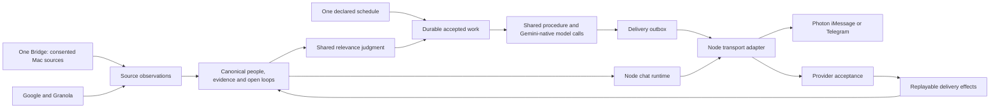

# Runtime architecture

## Current ownership and operational limits

Ownership and recovery contracts reconciled against main `099c29b8` on November 3.
The original readiness audit reviewed `7525695c`. The diagram below names existing owners;
capability presence is not release acceptance. See [runtime capabilities](RUNTIME-CAPABILITIES.md)
for the supported product boundary and its daily-use/release limits.

```text
Owner message → Node coordinator + durable journal → Mastra model/tool loop
  → typed tools → receiver admission → shared readers or confirmed actions
Consented source + Mac outbound relay → receiver → existing learning/task writers
  → canonical facts and obligation ledger
Receiver scheduler → leased work queue → skill procedure → validated artifact
  → outbox → provider acceptance (device display needs separate evidence)
External assistant → /client-mcp → granted, source-permitted read-only readers
```

The Node coordinator serializes same-thread turns; the model runtime also serializes generations.
A new same-thread input can cancel active generation before reprocessing durable inputs. It never
undoes a contacted external action. Chat queue wait is outside the active-turn deadline. Python
background work has separate leased worker slots; it does not need another conversation agent.
Runtime locks protect one local volume and are not a distributed multi-replica lease.

Only accepted assistant replies project into native conversation memory. Recall uses 20 messages
and a 65,536-character cap; canonical facts, obligations and source archives use existing tools.
Semantic, working and observational memory are disabled. Session resets and source-authority
changes can intentionally remove transcript recall. Historical edit/unsend corrections to learned
facts remain disabled pending source-identity qualification.

All contacted sends with uncertain acceptance remain held, including plain text. Accepted sends
are not repeated to repair later bookkeeping. Held or quarantined work can need operator attention;
this is duplicate prevention, not a guarantee of eventual delivery. Cold data restore and a
fresh-owner release journey remain unqualified. Self-host volumes have no migration path from
an older epoch; see [volume operations](../adapters/sotto/VOLUME.md).


Optional external-client access is a separate read-only entry point on the receiver. Native and
OAuth grants enumerate tools and expiry; current source consent is checked before and after reads.
The client chooses its own model and can receive private returned context. It cannot reuse those
grants for internal Bridge access, writes or Sotto's agent. Old grants do not gain new tool names.
The Bridge keeps dialing out; hosted clients do not connect directly to the Mac.

## Internal module ownership

The runtime and durable store boundaries above are unchanged by the November 5 structural refactor. Shared leaf modules own rules or mechanics used by several existing workflows; they do not admit work or add stores, retries or providers.

| Owner | Existing consumers and boundary |
| --- | --- |
| `_shared/lib/research_contract.py`, `research_providers.py` | Provider execution, prep composition/persistence and setup display share exact qualification/capability data without importing each other's orchestration. Retained evidence serialization stays deterministic; attribution is not proof of truth. |
| `_shared/lib/prep_selection.py`, `prep_identity.py` | Brief/prep selectors and proactive/attended naming use the same domain rules. Name enrichment returns its source explicitly; callers retain consent, source-use and delivery admission. |
| `_shared/lib/canonical_identity.py` | Knowledge, rendering and style share the original byte-sensitive ID minting. Each caller retains its own first-email selection, including legacy non-address fields; existing graph IDs still win. |
| `_shared/lib/source_authority.py`, `calendar_cache_contract.py` | Existing pipelines share authenticated live-authority transport; the calendar producer/consumer share their cache protocol. Workflow checkpoints, cache TTL and permission decisions remain separate. |
| `runtime/trigger-receiver/owner_route_authority.py`, `owner_tool_admission.py` | Existing route/identity authority and original-event tool admission have neutral owners. Each feature retains arguments, review, receipts and its canonical writer. |
| `runtime/trigger-receiver/owner_endpoint_http.py`, `installed_writers.py` | Bounded HTTP parsing/metadata and immutable installed-writer lookup are separate from domain invocation. The receiver's closed endpoint declarations inject existing dependencies; domain helpers own exceptional output bounds and cleanup diagnostics. |
| `runtime/sotto-chat/src/tools/owner-contract.ts`, `owner-tool-transport.ts` | Mutation clients share stable identity/options and bounded loopback I/O. Domain clients retain receipt interpretation, exact limits/deadlines and error meaning. Already-aborted requests stop before invoking fetch; no retry is added. |
| `runtime/sotto-chat/src/agent/tool-diagnostics.ts`, `src/tools/google-read-contract.json` | Content-free diagnostic collection/projection is separate from agent orchestration. Node and `adapters/sotto/google_read_contract.py` consume the same finite Google vocabulary; it grants no read or effect authority. |
| `adapters/sotto/bootstrap_runtime.py` | Managed/self-host bootstrap share exact health-only/environment mechanics while keeping distinct launch envelopes and secret cleanup ordering. |
| `runtime/local-reader/src/contracts.js`, `tools/descriptor_bundle.py` | The isolated reader shares limits/results without importing its launcher. Runtime/OAuth bundlers share sealing mechanics while retaining distinct schemas. The helper is explicitly included in standalone publication. |
| Native normalized message types | The normalized group roster cap is shared by native readers and watcher, without a watcher dependency on a source-specific reader constant. |

Optional input adapters remain with `jsonfiles`/`textutil`; live conflict projection is part of the existing knowledge model. The removed root iCloud repair command belongs to the documented legacy archive, not the active canonical writer path. These are implementation ownership changes, not release or live-provider acceptance.

## Background composition

Background proactive/event bundles now enter `compose_notification.py` directly after the existing
funnel. Fixed context readers and a bounded native writer compose them; no chat-engine turn is involved.
One primary item is delivered per push; unselected items retain coverage. Scheduling remains a
question when complete calendar coverage is unproven. Gathering reads the selected readable
calendars and reports partial failures; notification scheduling remains conservative. `model_work.py` owns durable per-revision
attempt claims and opaque receipts in `events/model-work.sqlite3`; validated artifacts survive
delivery retries. The proxy owns provider call accounting. Stable receiver job IDs distinguish
retries from later occurrences; dead-worker claims retain unknown spend and allow bounded recovery.
Notification source dates survive queue release and are displayed outside model-written copy.
Prep offers reuse exact-address mail already in the consented queue/snapshot, plus invitation and
graph facts; no source fetch or research call is added. Cached exact-address envelopes can supply a missing
prep name with delivery-time consent. Calendar-change copy comes directly from the detector:
dated moves, explicit cancellations, or a removed slot without guessing why. Context/prep entries
do not mint separate meeting-change nudges; unique nonrecurring iCalUIDs preserve identity across
replaced IDs. Calendar normalization retains explicit cancellation and recurring-occurrence metadata.
Brief extraction, critic and revision own separate retry allowances. See [bounded model
work](BOUNDED-MODEL-WORK.md) for contracts, storage and reports.

One page on what runs inside the container, who owns what, and which files cross between them. The
code is the source of truth; this is the map you read first. For *why* a nudge fired, see
[HOW-SOTTO-DECIDES.md](HOW-SOTTO-DECIDES.md); for every env var, [RAILWAY.md](../RAILWAY.md).

> **Prefer to click than to read?** [playground-architecture.html](playground-architecture.html) is
> this page made explorable — a layered node map of the same modules, threads and shared files,
> with saved views, a clickable drawer per node, and the shared-file sheet; every number on it
> is interpolated from the same rules island the drift guard checks against code.
> [playground-feedback-loops.html](playground-feedback-loops.html) does the same for the six
> self-improvement loops, each badged CLOSED, RECORDING or PLANNED. Both are single self-contained
> files: open them from disk, or visit `/static/playground-architecture.html` on a running deploy.

## Conversation execution and durable outcomes

The current Node coordinator owns conversation execution through Mastra. Shared Python skills, source authority, canonical knowledge, schedules and delivery records remain outside the model engine. Uncertain owner actions keep their typed receipt path: one small per-kind policy table (`runtime/sotto-chat/src/delayed-outcome-policy.ts`) controls only notice wording, cadence and allowed settled status. The original request receives an honest uncertainty notice; one coordinator wakeup (`ConversationCoordinator` in `src/conversation.ts`) uses the existing queues to inspect late proof without another owner message, repeated effect or held-only model call. It stops with the coordinator lifecycle. Source checks and kind-specific validation still decide whether proof can settle.

When source authority is incomplete, chat withholds prior recall and tells the model why;
self-contained questions remain answerable. A supplied accepted background message that cannot
be included also carries an explicit omission instruction. These signals never include withheld
text, grant tool authority, or restore conversation removed by consent/retention policy.

Queued skill status notices retain the admitted real owner chat ID and verified route digest. Receiver admission, enqueue and send each check that binding; source revocation can still permit a content-free failure notice, while source-bearing results require current authority. Accepted sends remain deduplicated, unknown sends remain held, and legacy aliases are never silently rebound. These contracts are locally tested; deployment and live evidence are recorded separately.

## Continuation acceptance limits

Short multi-turn continuation has scoped live evidence; arbitrary-query continuity remains unqualified. The
[conversation acceptance runner](../runtime/sotto-chat/evals/README.md) exercises person, company
and URL continuation through production code. Other workflow phrase gates, accepted-gallery
retrieval and large source results need their own journeys. Native Mastra history is present;
this is not an all-query continuation guarantee.

## October 17 boundary review

The architecture remains **one conversational agent over shared, durable capabilities**. Mastra
owns the model/tool loop, native skill discovery and bounded recall. Sotto's receiver owns source
permissions and the canonical records of tasks, knowledge, schedules and external effects. The
accepted-delivery journal projects conversation into Mastra memory; generated but undelivered text
is not a second history. Native working/observational memory remains disabled because it would add
another writer without Sotto's provenance, correction and revocation contracts.

| Decision | Existing owner | Boundary to preserve |
|---|---|---|
| What the owner means and which capability to use | `runtime/sotto-chat/src/agent/runtime.ts`, canonical skill instructions | Ordinary follow-ups use accepted conversation and tools; do not add a phrase router per failure. |
| What source data is currently permitted | receiver source authority, `src/agent/source-authority.ts` | Catalog caching is per turn; each invocation still checks authority. |
| Whether an external action happened | receiver receipts, Node journal and outbox | A model statement or queued job is not completion; unknown sends are never replayed. |
| Whether two displayed requests mean the same thing | existing brief critic in `compose_brief.py` | Duplicate names are review hints, not instructions to delete or force a rewrite. |
| Where a generated action link points | `_attach_tap_links` | Always rebuild from source-checked identifiers; a supplied or cached `tap_link` grants nothing. |
| Whether useful output reached the owner | outbox/provider acceptance, then separate device inspection | Unit tests and readiness are not content or display acceptance. |

The fresh-brief path still has serial extract → critic → conditional revision. The last measured
pilot run took 108.882 seconds to its final caption with one call at each stage. That establishes
neither per-stage attribution nor a latency fix. Keep the critic's source-bound closure/display
review; reduce unnecessary revisions and measure stage durations before replacing it. A duplicate
name alone no longer forces a paid revision, but a substantive critic finding still does.
The archived brief now retains the existing `metrics.summary()` as `_model_metrics`, containing
completed-call durations and token counts by stage. It includes no source text, excludes gather
and delivery time, and cannot account for a failed call that never returned usage. Model-supplied
metrics are discarded; missing telemetry cannot block delivery.

The three largest orchestration files are `conversation.ts`, `receiver.py` and `compose_brief.py`.
Prefer extracting existing pure presentation/projection code when changing it, with one entrypoint
and unchanged behavior. Do not introduce a second workflow engine, intent registry, durable queue,
or memory store to make these files look smaller. Framework replacement is not warranted by the
failures observed here. This is a scoped code review, not proof of every skill or lifecycle path.

Ask restart may reuse an explicitly completed partial persistence receipt only before any answer contact, within the existing staged-artifact retention window and unchanged source/context authority. It reuses the saved research and skips confirmed writes; unknown started stages remain held. Persistence failure still does not block an otherwise useful first answer.

Accepted conversation projection filters completed stable message identities in SQLite before loading message bodies. Owner input, accepted replies and frozen background deliveries have separate checkpoints, so late replies and deferred source groups remain eligible. Session rotation exclusions still use event identities, not a rowid high-water mark.

Accepted reply shortening checks the existing `conversation_memory_excluded` receipt for the
prior owner event and exact provider thread before loading its reply. Session rotation retires
that event even when the reply and new session share one millisecond. A current first reply can
legitimately share its session timestamp and remains usable; exclusions for another thread do
not retire it. The timestamp check alone does not establish this ownership boundary. This receipt protection
applies when conversation projection is enabled, as in the production `createSottoAgentRuntime`.
Custom agents without projection do not write these receipts and retain the older timestamp-only
edit-context boundary, including its equal-timestamp limitation.

Recent quoted scheduled text enters the model through a context-only projection. The journal
freezes its exact accepted dispatch with route, payload and source revision; the existing session
and 15-minute bounds apply. A scheduled dispatch must be created strictly after the current
session's start. Equal millisecond timestamps cannot prove session ownership and are withheld,
including a legitimate dispatch created in the exact session-start millisecond. The native
projection excludes those rows before loading their bodies. The projection does not feed
URL-target or action authority. The
shared quote helper for interactive replies remains unchanged. See
[continuity and learning recovery](solutions/continuity-learning-recovery.md).

## The spine — read this first

Daily and first-use briefs follow **gather → compose → validate → apply or durably defer essential memory →
check presented closures → deliver**, with ancillary learning queued separately. Meeting prep, the proactive watcher and
the midday digest have their own procedures and share the source, relevance and delivery rules.

| Stage | Owner | In one sentence |
|---|---|---|
| **gather** | [`_shared/scripts/gather_google.py`](../sotto-chief-of-staff/_shared/scripts/gather_google.py) (+ `gather_granola.py`, `_shared/lib/attachments.py`, the Bridge's `read_local`) | Deterministic Python pulls the raw material; no model is involved. Two facts it reads that nothing read before (Sep 2026): the stale-sent lane (`gather_stale_sent` — one `in:sent` search plus one `threads.get` per candidate: is the last word on the thread still yours?) and your own answer to each invite (`normalize_event.my_response`). |
| **compose** | [`_shared/scripts/compose_brief.py`](../sotto-chief-of-staff/_shared/scripts/compose_brief.py) | One Gemini call turns the gathered payload into prose and actions, plus the optional critic/revise pass — unanswered sent threads are candidate evidence for the model, never automatically minted debts. `_rsvp_actions` reflects explicit unanswered invitations that are nearly here. The model's own row for the same thread or event wins. After revision, a deterministic source-backed calendar preview precedes optional loop expansion; the model cannot delete its schedule. |
| **validate** | [`_shared/lib/brief_validate.py`](../sotto-chief-of-staff/_shared/lib/brief_validate.py) | Checks structure, identifiers and deterministic obligations; findings guide the critic/revision pass. These checks cannot prove every model judgment correct. |
| **commit essential memory** | [`_shared/scripts/learn_step.py`](../sotto-chief-of-staff/_shared/scripts/learn_step.py) `--phase essential` | Attempts extracted knowledge and continuity writes before handoff. Failed essential writes require admitted durable recovery; if admission also fails, the parent work retries the saved artifact. Presented closures still need exact committed version/evidence. The generation lock prevents replacement from discarding unfinished essential inputs. |
| **deliver** | `receiver.py` → `outbox.py` → Sotto adapter (`adapters/sotto/runtime_api.py`) | The outbox persists the artifact, checks its due time and current eligibility, then claims the brief marker at the send seam. A missing composed archive cannot claim the day. Structured provider acceptance completes delivery; retrying a known result does not recompose it. |
| **finish learning** | [`_shared/scripts/learn_step.py`](../sotto-chief-of-staff/_shared/scripts/learn_step.py) `--phase ancillary` | When admitted, durable background work finishes pending essential writes and runs draft outcomes, voice, Granola learning and Contacts synchronization. Essential retry admission is required before handoff after essential failure; ancillary-only admission failure does not withhold a valid brief. Optional ancillary work for a superseded generation is not guaranteed. The default `--phase all` retains the standalone seven-writer command. |

Before delayed brief learning, `brief_runner.py` projects saved source inputs through current
consent. If any consumed source is now disabled, shared `brief_evidence.py` rebinds each proposed
fact and its complete reference set to the remaining observed records. Unsupported facts and
empty identity stubs are removed. Legacy profile patches, relationships and company updates lack
individual evidence references, so they are held after a source change. Supported facts from
remaining sources still reach the canonical writer. The existing learning receipt reports partial
learning and hashes the exact projected inputs; retries reuse that receipt without repeating writes.

**The model judges meaning; code governs interruption and action authority.** Native Gemini classifies relevance, and the shared funnel applies cadence, consent, freshness and delivery policy. The Node chat runtime still exercises model discretion during interactive conversation; an adapter boundary cannot guarantee the quality of its replies. The funnel is documented rule by rule in [HOW-SOTTO-DECIDES.md](HOW-SOTTO-DECIDES.md), and
the seven things that can start a nudge are the producer table at the top of that page.

Event triage reads retained conversation context once and adds copied rows from the current ingress
batch before classification. The snapshot's optional inclusion predicate reuses the existing
`preferences.proactively_muted` path; muted words from queued, cached or newly arrived messages
do not enter the relevance context or the primary Tier-1 prompt. The context also applies the
existing deterministic Tier-0 message-noise rules. Email aliases, including case variants, use the shared source
normalizer for sender lookup without mutating the source event. The shared renderer selects bounded, dated context
by exact source/thread identity. Unrelated retained threads are removed before mute-name resolution;
explicit name mutes may use the existing graph reader once per missing contact identifier per
batch. No such lookup is added without name mutes, and an explicit empty batch reads no retained
context. Quiet/snoozed batches skip review-context construction entirely while retaining their
ordinary queue/drop handling. Later same-batch evidence can therefore prevent an obsolete wake-up
through the existing relevance judgment. No second inbox, model stage, scheduler or writer is added.

`personal_context` owns the shared transport sender resolver and per-batch mute filter used by
triage, notification enrichment and cached meeting-offer mail. Composition excludes newly muted
candidates before writing and resolves muted names in the exact selected thread's background.
Only the rendered notification adds a minimal `notification_sender` projection to its existing
eligibility effect. `delivery_effects.valid` re-reads current preferences for that selected sender
before provider contact, including after restart. It stores no extra copy of message prose and
adds no file or writer. Legacy effects keep their existing validity checks; uncertain contacts
continue through the outbox's existing receipt-reconciliation path.

The daily inbox body cohort reads each exact Gmail thread once and reuses the same bounded,
dated opening/latest excerpt as meeting prep. The selected message keeps its own body, ID and
attachment payload. Thread background stays separate so an older sentence cannot become proof
attributed to the newest message. Drafts, trash, spam, future-dated messages and messages from
muted senders are excluded;
permission is rechecked after reading. A failed thread read retains only the search excerpt,
marked incomplete, without another provider attempt. Historical/backfill and sent-only reads
keep their existing paths. This adds source context, not a new model stage or memory cache.

**Review context is evidence, not authority.** The brief critic receives the same rendered,
consent-projected open commitments as the writer, plus each selected action's complete ask and
recipient identity. Its email index labels dates, direction and truncated snippets; that index
cannot prove an absent fact is invented or a task is complete. Optional summary/prose fields
carry distinct context rather than retelling the ask. Exact closure evidence and review receipts
still govern state changes. This reuses the existing critic call and task renderer; it adds no
model stage, intent router or memory store. Style guidance similarly quotes each exact sample
once while preserving different messages that happen to share an opening.

Task-word matching supplies review hints, not a factual verdict or an automatic paid rewrite.
Within that same critic call, a semantic display verdict can establish that a selected task is
fully shown without copying its old wording. Code binds the verdict to the exact task version,
source-supported recipient and unchanged line, still under Needs Attention or Should Handle
(whitespace and a final period after a word or number are presentation; a question mark is not);
a line moved to another section, or a missing, conflicting or stale verdict, keeps the
existing backstop. This affects presentation and delivered-task attribution only, never closure
or permission to act. Relevant message conversations reuse the writer's consent-filtered renderer.
Daily email background spends its existing budget on messages not already rendered, retaining up
to eight dated messages so a middle-message agreement is not displaced by duplicate current text.

**One shared Gmail reader and client.** `_shared/lib/gmail_read.py` owns native Google client
construction on the existing `google_token.json` and recursive Gmail MIME body extraction.
`poll_gmail.py` and `gather_google.py` use the same full-message reader; nested multipart mail
retains its plain-text body or readable HTML fallback instead of becoming a search preview.
Failed message reads remain unacknowledged for the next poll while other messages proceed.
The gather reuses the full message's MIME tree for attachments. `gather_google._gmail_service`
remains the entry point used by `google_action.py`, backed by the shared builder. Search and
calendar commands go through Sotto's packaged Google CLI, `adapters/sotto/google_api.py`.
The ordinary gather uses `_shared/lib/calendar_gather.py` to start Calendar in one bounded
worker after the shared token check,
while the calling thread reads inbox, sent, stale threads and loop context in their existing order.
Calendar creates and closes its own Google client; it shares no Gmail transport. Gmail quota
failures still stop later Gmail lanes, while Calendar can finish independently. The caller joins
Calendar before meeting context reads either result, then rechecks source grants before writing
any source rows. Pulse and attendee-only gathers keep their existing paths.
The attachment half converts what it fetched through
[`_shared/lib/attachments.py`](../sotto-chief-of-staff/_shared/lib/attachments.py), the owner of the
lane's three caps for both the fetch side and the prompt side: *an attachment Sotto can read becomes
text under its email; one it can't is named, never guessed.* Conversion is in-process and local —
no hosted OCR, no API key, no env var (see [HOW-SOTTO-DECIDES.md](HOW-SOTTO-DECIDES.md) §
*Attachments*).

### Meeting reminders use the same stored context

`compose_notification.py` enriches the attendee from the existing person-memory query and
permitted cached conversation, then uses its existing bounded notification writer. The reminder
selects one or two useful sentences: where the relationship left off, relevant shared context,
or a supported commitment. Introductions and meeting purpose are useful when known, not required.
An old topic is not today's agenda and a stored task is not proof it remains unfinished; the
writer checks current evidence instead of appending the scanner's task summary verbatim.

The context remains capped at 60 words / 500 characters, followed by the named prep offer. Cached
mail contributes at most five excerpts; no new source fetch, web research or model stage is added.
Existing artifact reuse and admission limits remain in place. With insufficient evidence or a
held/failed writer, the basic identity/time reminder still goes out without an unreviewed task.

### The open-loop path — input to outcome

There is one continuity ledger, one shared evidence view, and one existing model pass that can
propose changes. A loop is a particular obligation with an owner, counterpart, original source and
revision; a person or conversation can have several. Stored open status is prior bookkeeping,
not proof that later work never happened.

```text
Current permitted evidence + prior obligations
  → bounded gather: retain source IDs, original dates, direction and incomplete coverage
  → existing brief model: propose a new task or an update to one exact task
  → existing optional critic: check meaning against bounded original source context
  → continuity writer: validate task revision, identity, source, time, direction and quote
  → same ledger: persist accepted changes; preserve unresolved tasks on missing evidence
  → brief / Loops page / proactive watcher; delivery receipts count actual nudges separately
```

The model reasons about fulfillment, acknowledgments, promises and changed responsibility; code
does not look for completion keywords. A new follow-up is separate from the task just completed.
No reply, elapsed time, or archived email is itself a closure. Explicit user locks remain manual.
The writer is local, not another model agent; a rejected update leaves a bounded rejection reason
in the existing learning receipt. Retrying a saved valid brief reuses its artifact and inputs.

Granola commitments enter that same ledger through their existing revision-aware capture path:

```text
Granola notes / summary / transcript
  → gather_granola: meeting_id + exact start/end + source text
  → ancillary Learn capture: up to 3 new/changed revisions from the 14-day overlap;
       successful revisions checkpoint in the existing learned receipt, failed writes retry
  → compose_followup: owner_is_user + verbatim source_snippet + optional existing_anchor_key
  → apply_commitments:
       meeting id + copied quote + named owner + action/deliverable words must match source (or drop)
       same meeting + direction + source snippet → same occurrence
       validated live same-direction anchor     → merge with that open loop
       otherwise                                → create a new open loop
  → continuity ledger → brief / Loops page / proactive watcher
  → triage verdict with decision_id
  → receiver send → delivery receipt with the same decision_id
       delivered → count “already nudged” and finalize a chase/handoff
       failed     → neither
```

Capture does **not** wait for a confirmation turn: private bookkeeping is written when the grounded
extraction succeeds. Both composition and the actual write recheck four mechanical model claims
against the gathered meeting: its id exists, the supporting quote was copied, that quote names the
claimed owner, and it contains the obligation's action/deliverable words. Ambiguity drops the
item instead of opening a loop. Exact occurrence identity handles reruns; the model may suggest at
most one semantic merge, and code accepts it only if that anchor is live and points in the same
direction. There is no fuzzy-matching subsystem. New source-backed Granola commitments close like
every other obligation: through a `resolved` loop update that passes the code checks below and that
the brief's critic reviewed. An explicit user lock remains manual. An ordinary reply, an old
creation date, or the user's own chase cannot silently erase either.

The same ledger owns every obligation. Separate asks remain separate rows and the brief groups them
once per person only when rendering.
Stored open status means the last reconciliation has not closed the task; it is not evidence that
later work never happened. The brief model evaluates the particular obligation against the
conversation timeline and may provide a concise `reason` with its evidence-bound update. Code
checks identity, direction, time and a verbatim quote of at least 12 characters
(`MIN_EVIDENCE_QUOTE_CHARS`); it keeps no English completion-verb or task-word whitelist. Meaning is
judged by the critic: a `resolved` update applies only when it carries the `criticReceipt` that
`compose_brief` stamps after a completed critic pass reviewed that exact update (loop, revision,
status and evidence), backed by a persisted positive verdict in `events/loop-reviews.json`.
The public proposal digest alone cannot claim a review. This is application provenance, not a
security boundary against a process with write access to the volume. A closure the critic skipped, could not run, held, or could not fit in its
review stays open for the next brief; `waiting` updates do not need the receipt. The brief
projection and Learn's resolver share this check, so the brief never shows a closure Learn would
refuse. If a rejected closure remains open, unmarked Already Handled claims are omitted rather
than guessed by name; independently verified, task-marked completions remain. A reply may fulfill, acknowledge, or defer work; one message can fulfill one task and
create another. These semantic distinctions belong to contextual reasoning, not keyword-triggered
closures.

`local_snapshot.resolve_effective_local` resolves live/cached local inputs once before the runner's
knowledge query and continuity pass. Composition and Learn share that consent-filtered view,
including original per-source observation times; cached messages are never re-stamped as live.
A bounded attended read (the relationship pulse's incremental Bridge refresh) uses
`local_snapshot.merge_local_unsaved`: the same merge in memory, never replacing the snapshot or its
day archive with a narrower window.
Source grants and derived-email dependencies are checked again at consumption and delivery.
The native daily runner also requests `gather_google --loop-local <effective-local.json>`: the
Gmail gather's bounded supplemental refresh interleaves exact Gmail threads or verified counterpart
addresses with direct iMessage handles verified through canonical identity. No name search,
per-loop model call, or new polling job is used. Gmail group addresses rotate within the shared
target allowance; the text lane selects direct counterparts only. Snooze, due and rotation days
use the ledger's configured local day. A WhatsApp JID is never a mail address or an iMessage
endpoint, and drafts, trash and spam are never evidence. The obligation's origin, channel and
alias dependencies must remain permitted for the read and for consumption of its evidence.

Text reads run concurrently within the same target, request, message, character and time allowances
as Gmail. Each selected exact handle supplies at most its newest 24 native messages within the
native 90-day limit. Only verifiable messages after an original ask and no later than this pass
are admitted; oversize texts are omitted intact. Their native event timestamps are preserved.
Supplemental texts render separately as `LOOP_EVIDENCE`, for reviewing existing obligations through
the existing critic and resolver. They do not enter ordinary daily grouping, triage, signals,
ordinary fact/style learning or new-ask/reopen capture. They do not replace the daily snapshot or expand its
source-wide coverage. The refresh itself never writes task state.

Complete native Gmail bodies can be reused when this gather's thread inventory proves every
selected message is present; a snippet or one message does not prove a whole thread was read.
This is in-memory reuse only. Archived targeted replies retain a bounded body excerpt and message
ID in the prompt, so fetched evidence is usable without treating archive status as completion.
Any Gmail lane hitting quota stops supplemental loop reads; failures preserve earlier successful
rows. The source receipt remains partial, recording omissions: this bounded sample never proves
absence of completion or a complete history search. Hosts using MCP dumps retain supplied evidence
without this native refresh.

| Loop reconciliation cost | Bound / reuse |
|---|---|
| Added model stages | None. Proposals share extraction and are reviewed inside the existing critic call. In `SOTTO_CRITIC=auto`, a brief proposing any closure of an open task always runs the critic (one call, plus a revision only when it finds issues), so a quiet brief that would have skipped review now costs that call. |
| Supplemental Gmail + iMessage | Six shared targets, ten source requests per fresh composition; no additional lookup on saved-artifact learning or delivery retry. Fresh recomposition uses a new bounded gather. |
| Added source bodies | At most 24 messages across both lanes, 2,000 characters each, 48,000 total; these are character limits, not exact token limits. Duplicate message IDs render once. |
| Critic evidence | At most eight proposed updates (closures first) × two original excerpts, sharing one 16,000-character budget (2,000 per excerpt at most), plus bounded task/quote metadata, inside the existing critic call. A closure past these caps is held for the next brief, not applied. |
| Time | Stop admitting supplemental reads after 20 seconds; concurrent text reads receive the remaining budget. One in-flight Gmail request can run to its normal 30-second timeout. |
| Storage | Existing temporary brief inputs and ledger/learning receipts only; no new persistent raw-message cache, completion service or state machine. |

Group conversation IDs remain opaque across the ledger, and an email can pay a group obligation
only when it is addressed to the whole roster: every participant the group's own messages list, each
through a verified alias. Name similarity cannot join people. Bridge reads and watcher events retain sent group messages without a per-message handle;
`is_from_me` identifies the author and the chat GUID identifies the conversation. Excluded group
participants suppress the whole group rather than exposing their message context.

Optional model `loopUpdates` name one ledger ID and revision
plus a source message ID and verbatim quote; the writer verifies counterpart, direction, original
timestamp and quote against the snapshot, and applies a closure only with its critic review receipt. Generic replies, links, calls, calendar contact, age,
passed deadlines and unreachable counterparts cannot close or expire an obligation. Something you
owe that nothing has touched for 14 days may park (`status: parked`, `parked_at`; the clock is
`ledger_io.last_touch_day`). The composer attaches exact `parking_notice` effects to its warning;
`brief_runner` stages them in the existing outbox and `delivery_effects.finalize` calls the locked
continuity writer after provider acceptance. `parking_notice_at`, `parking_notice_touch` and
`parking_notice_version` bind that receipt to the unchanged task. Only an accepted notice from an
earlier local day permits parking. Model-supplied notice metadata is discarded; the pre-send check
revalidates the task and its mutes, and a stale warning uses the existing brief-replacement path.
No warning or a stale notice leaves it active. The file stays;
`load_active()` skips parked rows, and re-capture or `keep` reopens one with `reopened_at`.
Snooze's return date restarts the parking clock; keep/snooze never rewrite the original request
date or completion cutoff. A valid completion proposal can resolve a parked task. `/api/loops`
serves the parked group apart from the open list, with `keep` as its verb.

## Accepted work and delivery

### Boundaries to preserve

The unit of deployment is one tenant runtime, with the same backend and skill pack in Cloud and
self-host. Keep new behavior within these owners:

| Responsibility | Authoritative owner | How a new feature uses it |
|---|---|---|
| Source access and authority | Shared source/consent checks; Bridge executes Mac operations | Add a normalized reader or an explicitly approved action, with the same checks in both modes. |
| Meaning and memory | Shared relevance judgment, cited knowledge graph and continuity ledger | Store durable facts or live obligations through their existing writers. History checkpoints describe progress, not another memory store. |
| Scheduling and execution | Receiver and `work_queue.py` | Declare a procedure on the existing schedule. Preserve its input identity, deadline and saved result across retries. |
| Automated delivery | `outbox.py` and channel adapters | Hand off the saved result once. Adapters return transport receipts; delivery effects update the existing domain stores. |
| Interactive conversation | The Node chat runtime (`runtime/sotto-chat`) under the root supervisor | Keep channel formatting in adapters. Chat does not create a second scheduled brief or memory implementation. |
| Managed accounts and spend | Cloud account service and model proxy | Authenticate tenants and enforce spend at admission. These services do not own relevance, memory or scheduling. |

The chat engine sits behind the adapter boundary, not inside a procedure. `runtime/sotto-chat`
uses Mastra for model turns and conversational context and Chat SDK for provider intake. It owns
neither source consent, the canonical graph/continuity ledger, the receiver clock, nor the outbox.
Its transcripts and dispatch journals are operational state, not a second authority for those
facts. The fixed-five profiles are intentionally limited to their closed procedures; they do not
prove general tool parity. Swapping the chat engine would still require an adapter that preserves
tool authority, turn cancellation, queued-action stop behavior, source-revision invalidation, and
provider acceptance receipts; the current implementation binds these to Mastra/Chat SDK lifecycle
APIs.

The Chat SDK's SQLite state is also operational, but cannot be replaced with memory alone.
Telegram persists pending updates before advancing its provider offset; a failed admission may
not yet have a Sotto journal row. Retaining this small transport store lets that pending message
survive a restart. The SDK store is not a second knowledge graph or delivery authority.

Work and delivery are separate recovery stages because a completed model result must survive a
transport outage. Their records are not interchangeable. A new queue, scheduler, store or service
needs a responsibility that none of these owners can serve; a new feature alone is not that reason.



`events/work.sqlite3` owns **work before composition completes**. The existing
`events/outbox.json` remains the only owner of sends and their retries. These are sequential
stages with an idempotent handoff, not competing delivery ledgers. A job has a stable ID, due
time, useful deadline, separate composition and handoff attempt counts, and a renewable lease.
Each phase allows three attempts. Shutdown stops new dispatch, terminates tracked children and
gives each worker a fair share of a ten-second grace to return its own lease. A graceful stop
refunds its active phase, including the delivery handoff, where the worker has no interrupt path
and a send may outlast the grace: the shutdown itself refunds every lease its workers could not,
and a worker that settles concurrently makes that refund a no-op. Children still running at the
deadline are killed rather than orphaned, before any refund makes their job claimable again. A
refunded job is immediately claimable, and it keeps its committed composition, so the next instance
resumes at the handoff instead of composing a second time. An ambiguous crash still
consumes the attempt. Exhausted jobs are closed while the same claim continues to the next due job. Its exact completed output is committed
before handoff, so a crash there does not buy another composition. Duplicate queue items retain
ownership even if a later valve batch groups them differently. Retrying terminal input releases
only that input's alias; unrelated failed work retains ownership. Raw inputs/results are removed
from terminal work rows; diagnostic metadata lasts seven days. Explicit owner brief requests
retain only their route and label alongside the job until outcome feedback is handed to the
existing outbox (or is no longer needed), at most the same seven-day retention. The five-second
work dispatcher reconciles failures, including expiry before a worker starts. It does not run a
model to report a failure or create a second delivery ledger.

Telegram owner-requested morning/evening briefs use that same queue and outbox. Scoped admission
captures the protected pairing's owner and bot fingerprint, loaded runtime route, and source
revision in immutable job metadata. Composition, saved-result recovery, delivery and terminal
feedback recheck that original binding; relinking cannot move existing work into the new chat.
The binding remains available after payload/feedback scrubbing until ordinary job retention ends.
A lost admission response is inspected across restart, and unknown delivery remains held without
recomposition or another send. Photon keeps its existing activation and destination checks.

The receiver runs at most two jobs concurrently, with at most one background job. Interactive
chat is the separate supervised Node process. Due work normally has priority; background work waiting
30 minutes receives a turn without occupying both slots. This keeps history and secondary learning
from starving under sustained traffic. Each lease has a distinct owner token, so an expired worker
cannot commit a replacement worker's result. The queue lives on the existing tenant volume.
Schema migration and mutation share one immediate SQLite transaction. Opening the queue preserves
its journal mode: fresh stores use SQLite's rollback journal and existing WAL stores retain WAL,
both with full synchronous durability. Admission does not race a journal-mode change at startup.
Shared JSON sidecar locks allow nesting only within the owning thread; concurrent threads and
processes remain excluded, including when consuming a one-use approval before a send.

The receiver loads shared delivery code from the immutable image's `/app/sotto-skills/_shared/lib`
or the equivalent source-checkout path, never from the writable volume. Startup validates the
mandatory delivery imports before serving health checks. The image build imports the packaged
receiver as the receiver UID, checks the five fixed schedules, admits the declared runners and
refuses an undeclared one, without credentials, model calls or external sends; device display
remains a live check.

Daily jobs can recover within four hours of their declared time. The separate ten-minute
wake-folding window describes a currently composing brief, not the lifetime of accepted work.
Normal brief preparation starts ten minutes early. The outbox's `not_before` holds its completed
text until the declared time; consent and relevant Calendar facts are checked again before claiming
the brief marker. A changed context revision permits a fresh composition. A slow essential model
call or prolonged outage can still miss the deadline; health exposes outstanding/failed work
rather than claiming punctuality it cannot prove.

Source outcomes distinguish successful empty reads from partial, unavailable and disabled reads.
A failed Calendar refresh retains the last good observation and cannot manufacture cancellations.
A revoked source is excluded from cached inputs and contextual memory. Observation timestamps and
coverage remain separate from the time a cache file is rewritten.

After provider acceptance, an outbox row drops its message text and retains `effects_pending`
until the associated bookkeeping succeeds. A separate cross-process file lock serializes these
callbacks without holding the main outbox lock; a slow callback cannot be reclaimed after its
retry timestamp. Callback process crashes also consume the five-attempt limit; an exhausted row is
quarantined before invoking it again. A quarantined row keeps what diagnoses it — its acceptance
receipt, label, run id and failure reason — and drops the effects' per-source addressing exactly as
an applied row does, so no handle, address or thread id survives in a row that will never replay.
Retrying those effects never resends the message. Closed receipts remain for
seven days after terminal delivery or effect settlement, including delayed recovery.
Chases, proactive seen state, intention completion and detached offers activate after acceptance.
An offer must correspond to the actual delivered question; multiple unanswered questions require
clarification. Acceptance is a provider receipt, not proof that the user read the message. A network
failure after an uncertain send remains an explicit ambiguity; universal exactly-once delivery
cannot be promised without a provider idempotency contract.

Optional research uses prepared/cached results. Notes in `cache/brief-granola.json` are reusable for
24 hours, with a freshness warning beyond 30 minutes, and expire under the one-day retention rule.
Welcome voice/identity seeders share a 20-second allowance. Essential knowledge and continuity writes
are attempted before delivery; nonclosure writes may defer, while presented closures require the exact
committed version and evidence. Draft outcomes, voice learning, meeting-note learning and Contacts
synchronization use a durable follow-up when admitted. Its admission may fail without suppressing an
already valid brief; retained inputs and pending markers do not alone prove later recovery. Historical
learning leaves capacity for the existing Dreamer; explicit user corrections remain authoritative,
and silence is not negative feedback or permission for an external action.
The existing memory heartbeat also runs weekly stale-fact archival through the canonical graph
writer and lock, recording its success in `history-state.json`. It adds no scheduler, model call or
store; owner corrections, Contacts-card notes, corroborated facts, preferences and continuity tasks
are retained. An unreadable person file is skipped and counted rather than blocking the sweep.
Repeated or reference-free fact proposals leave evidence recency unchanged; only distinct source
evidence or an explicit correction refreshes it. A temporarily forbidden history source holds its
existing cursor and performs no learning until permission returns.

## Boot

This is the one description of what happens when a Sotto container starts; the setup and operator
docs link here.

1. **Tini and one bootstrap.** Tini is PID 1 and runs one root bootstrap as its direct child:
   `adapters/sotto/selfhost_bootstrap.py` (the root `Dockerfile`; Railway mode reads
   `SOTTO_SELFHOST_LAUNCH`, operator-file mode reads a root-private file) or
   `adapters/sotto/managed_bootstrap.py` (Sotto Cloud, `SOTTO_MANAGED_LAUNCH`). Startup
   refuses unless it is root, not PID 1, and alone with Tini in a private PID namespace. In Railway
   mode it also checks the envelope against Railway's injected project, environment, service,
   domain, volume mount, setup marker and `PORT=8080`. It stages the bundle as a private file,
   clears its own environment and runs one of two modes.
2. **`--prepare`, once per volume.** `prepare_fresh.py` accepts only a truly empty ext4 `/data`
   (at most an empty `lost+found`), takes `.sotto-runtime.lock`, creates `sotto-home/` (UID 10001,
   0700), makes `/data` root:10001 mode 01771, and writes the root-owned `.sotto-volume.json`
   tenant/volume marker last. An interrupted preparation leaves a nonempty volume for an operator;
   it is never resumed. The bootstrap then serves only `/health` on port 8080 for at most 15
   minutes and starts neither runtime.
3. **`--run`, first start and every restart.** `root_supervisor.py` validates the bundle, pins the
   observed `/data` mount, renders the Node config and receiver projection (`startup_config.py`),
   picks the fixed-five profile from the manifest's deployment and channel, and builds both
   children's argv and complete environments (`process_handoff.py`; nothing ambient is copied).
   `tenant_lifecycle.py` takes the tenant flock (`runtime_lock.py`), proves the namespace holds no
   other consumer and becomes the subreaper. The supervisor creates Node's private `node-config/`,
   `node-state/` and `node-media/` (UID 10000) and has `role_stager.py` write each role's
   projection as that role's UID. `native_replacement.py` checks the closed profile offline
   (`fixed_five.py`), then writes the replacement epoch `.sotto-epoch.json` on a first start or
   verifies it on a restart (`replacement_epoch.py`, [VOLUME.md](../adapters/sotto/VOLUME.md)).
4. **The two children.** Node (`runtime/sotto-chat`, UID 10000) starts first. The receiver runs
   with general stdout/stderr suppressed. The supervisor passes a duplicate of its stdout as
   `SOTTO_SETUP_LOG_FD`; the receiver writes only the private setup-link boot line there, then
   removes the variable and closes the descriptor before starting worker threads. Node has no
   such descriptor. This preserves onboarding without forwarding runtime/source logs.
   It starts through `managed_exec.py`, which captures the control credential (`control_vault.py`), drops to
   UID 10001 and makes the process nondumpable before importing it. The receiver verifies the
   loaded Node identity before starting workers or serving requests; scheduled slots wait for the
   current owner activation.
5. **Running and stopping.** The supervisor watches both process groups and the mount; any child
   exit, including a clean one, stops the instance so the platform restarts it. On `SIGTERM` it
   sends the verified Node leader `SIGUSR2`, keeps the receiver available for up to 35 seconds of
   Node cleanup, then stops the rest within a 45-second bound, holding the flock until every owned
   process is reaped.

## The two processes

The receiver owns scheduling, accepted work, source authority, canonical memory and delivery.
The Node chat runtime owns its interactive model/tool loop and transport state. The launch
manifest binds one owner channel (Photon or Telegram) for chat and outbox delivery. The receiver
owns and stops its detached worker groups. No extra supervisor service is required.

`adapters/sotto/runtime_api.py` is the receiver's only runtime adapter: loopback text and gallery
sends, late receipts, session rotation and runtime readiness. The receiver owns the durable job
and outbox stores, and the adapter returns provider acceptance metadata rather than making
business delivery claims. The control credential stays out of Node and worker environments. That
inheritance boundary does not sandbox an agent that has unrestricted access to tenant files or
processes.

The Node half, all under `runtime/sotto-chat/`:

| Path | Owns |
|---|---|
| `src/conversation.ts` | `ConversationCoordinator`: owner-input queue, model turns, acknowledgements and the delayed-outcome wakeup |
| `src/delayed-outcome-policy.ts` | The per-kind table of notice wording, settled statuses and inspection cadence for uncertain owner actions |
| `src/journal/index.ts` and `src/journal/owner-task-selection.ts` | `OperationalJournal` and its synchronous accepted task-selection repair binding, `operations.sqlite` in Node's state directory: inbound events, runs, actions, prepared replies, dispatches and their attempts, activation evidence |
| `src/channels/` | Chat SDK intake and sends (`gateway.ts`, `sdk.ts`), Photon and Telegram credentials, presence tapbacks, the Photon text formatter and media hydration |
| `src/tools/` | Model tools and their receiver clients (the `owner-*` tools), read admission and its shared `read-policy.json`, the closed script runner |
| `src/agent/` | Mastra agent construction (`runtime.ts`), Bridge source tools, source authority, typed Google reads and accepted brief detail |
| `src/bootstrap/` | The strict config schema (`config.ts`) and process wiring (`main.ts`), including which owner tools each channel gets |
| `evals/` | The actual-model conversation acceptance runner (`conversation.ts`) over synthetic sources and captured delivery |


Numbered task spans use `src/tools/owner-task-scalars.ts`. The receiver writer uses pure `_shared/lib/cleanup_selection.py` predicates for complete displayed scope and bounded numeric answers. These helpers add no state store or receiver authority; admission and writes keep their existing owners.


## Receiver modules

All under `runtime/trigger-receiver/`; most modules are stdlib-only, while managed pairing uses the
image’s pinned cryptography dependency. `receiver.py` loads its hook-based helpers with
`importlib` and injects `HOOKS` — late-bound lambdas over its own globals — so no module ever
imports the receiver back.

| Module | Owns |
|---|---|
| `shared_lib.py` | Immutable caller-anchored shared-module lookup for receiver, dashboard and calendar cache, using the receiver directory, image skills tree or source skills tree; never the writable data home |
| `setup_markup.py` | Pure setup page shells, navigation and tile markup; receiver re-exports its existing renderers and keeps setup state and HTTP orchestration. |
| `managed.py` | Managed activation/source checks, granted Google scope receipts, and the one-time source notice policy. Missing or foreign tenant state holds scheduled briefs, including Bridge wake triggers; self-host behavior is unchanged. |
| `onboarding.py` | Durable first-use reservation and delivery acknowledgement; read-only setup progress, recovery after failure and preservation of established installations |
| `brief_runner.py` | One deterministic daily/first-use procedure in Cloud and receiver-based self-host: durable artifact and inputs, essential knowledge/continuity writes, exact chat text, deferred ancillary learning |
| `procedure_runner.py` | Shared proactive, digest and relationship-pulse procedures; eligible proactive results use deterministic templates or the bounded direct writer, and reviewed digest coverage advances only after delivery acceptance |
| `work_queue.py` (shared library) | SQLite ownership of accepted work until output is handed to the outbox; stable input IDs, bounded leases/retries, two worker slots with at most one background worker |
| `receiver.py` | The HTTP surface (`/health`, `/sotto/trigger`, `/chat/brief`, `/bridge/*`, `/mcp`, `/runtime/*`, `/selfhost/*`, `/cloud/*`, `/pair`, `/setup*`, `/google/*`, `/connect/*`, `/debug/*`; `dashboard.py` owns `/app` and `/api/*`), brief trigger dedup, the system schedule (`crons.json`), the event funnel's dispatch half, the setup wizard page, and every skills-tree subprocess it forks |
| `adapters/sotto/startup_config.py` | Offline explicit-manifest renderer for strict Node config and a separate receiver URL/token projection. Private bounded input, derived MCP read bearer, cross-field channel/owner binding, explicit Photon first-owner-DM line configuration and atomic no-replace staging; no live credential lookup, consumer startup or readiness change. |
| `dashboard.py` | The Window: `/app`, `/app/login`, `/static/*`, `/api/*` — sessions, CSRF, CSP, lockout, the JSON API, and every write lever (facts, loops, prefs, cadence, graph, voice, run-now, golden labels). Managed `/app/cloud/start` and `/app/cloud/consume` bind a Cloud grant to the receiver browser before minting a session; Cloud-issued sessions recheck their broker lease at most every 30 seconds. Existing local setup-code sessions remain an independent operator path, and self-host sessions need no Cloud broker. |
| `cloud_pairing.py` | Managed account/Bridge handoff and device revocation; its control-authenticated dashboard grant endpoint writes the one-use grant into `config/cloud-pairing.sqlite` and checks the Cloud broker before redemption. No setup code or control bearer enters the dashboard handoff URL. |
| `calendar_context.py` (copied from `_shared/lib/` by Docker) | Shared human-attendee normalization, explicit user participation, owner busy-time eligibility and the schedule day grammar used by composition and card layout. Slot proposals and notification holds exclude free/working-location/cancelled/declined events and shared entries without owner participation, using existing Google fields. Explicit context notes with the exact same interval and a unique matching meeting subject attach to that meeting as `supporting_context`; their descriptions remain available for prep, without creating a second busy block or invite. Calendar diffs only nudge for declines in the user's one-to-one meetings; prep and docket exclude resource rooms. |
| `sotto-chief-of-staff/_shared/lib/calendar_prep_projection.py` | Pure day-cache row projection and meeting-prep notification templates; no reads or writes. Calendar refresh remains the sole cache writer; accepted receipt changes remain in `delivery_effects.py`. |
| `calcache.py` | The ONE calendar cache — the `gather_google.py --skip-gmail` fork, its 10-min TTL, the refresh thread that writes `cache/calendar_today.json`, the post-meeting tap detector, and the calendar-diff detector with a durable comparison baseline (declines, last-minute invites, moves, cancellations → `calendar_change` events into the funnel). A meeting the user DECLINED is dropped before the served list (the Today view and the funnel's in-meeting hold never see it) while the raw wire events keep it for the diff |
| `connectors.py` | The connector registry, both kinds: remote-MCP OAuth 2.1 (discovery → DCR → PKCE → token file) for the Connect tiles, and the key-based search providers it renders read-only beside them — **and `write_text`/`write_json`, the one atomic-write helper the whole image uses** |
| `outbox.py` | The durable delivery outbox — `events/outbox.json`, the idempotency key, the retry backoff, the per-kind expiry, and the drain heartbeat. **Nothing Sotto says is marked delivered until the channel says so; what fails waits its turn instead of dying.** |
| `runtime_retention.py` | One authenticated loopback call from the receiver's existing retention sweep to the Node chat runtime; it shares the adapter's loopback client and owns no clock or TTL. |
| `retention.py` | THE table of what the volume keeps and for how long — every TTL, the three policies that apply them, and the guard that keeps the graph, the ledger and the corpus off every rule. Its sibling `retention_paths.py` checks file and lock paths before cleanup. It owns no clock: `receiver._retention_tick` fires it once a local day from the cron thread. **Retention is machinery, not an instruction a run can decline.** |
| `tzchain.py` (a copy of `sotto-chief-of-staff/_shared/lib/tzchain.py`, placed here by the Dockerfile) | THE timezone chain — `SOTTO_TIMEZONE → TZ → the wizard's config/settings.json → UTC` — resolved by one file in every runtime: the skills import it as a sibling, the receiver and dashboard load it by path (this copy in the image, the original in a checkout). Four hand-mirrored copies drifted on their last rung (server local vs UTC), invisible on Railway and a day off on any other machine after 5pm (Sep 2026). |
| `relay.py` | The reverse-MCP relay: the Mac long-polls `/bridge/poll` and answers on `/bridge/respond`; the Node chat runtime calls `/mcp` on loopback; no tunnel |
| `runtime_read_admission.py` | The Python half of the shared read policy: loads `runtime/sotto-chat/src/tools/read-policy.json`, the same data Node's `src/tools/read-admission.ts` uses, and rechecks request, subject and cancellation independently for owner URL reads and skill requests |
| `runtime_owner_*.py` | The receiver side of each Node owner tool, each behind a private `/runtime/owner-*` route and loaded with `_load_shared_lib`: Calendar moves, Contacts changes, exact-reviewed Gmail drafts and sends, reviewed Mac sends, task tools and the explicit `/loop` writer, reminder commands and tools, routines, preferences, quiet commands, brief / meeting-prep / skill requests, offer replies and owner URL reads. Effects keep their existing writers, queue and receipts |
| `owner_google_effect.py` | The guard the attended Google effects (Calendar, Contacts, Gmail) share: refusal type, installed Google action module, source-authority and grant check, and the post-acceptance read-back decision |
| `runtime_knowledge_read.py` | Closed inline access to the canonical knowledge query behind `/runtime/knowledge-read`; never a script runner |
| `runtime_activation.py` · `runtime_channel_proof.py` · `telegram_channel_proof.py` | Channel proof: validate Node's durable owner-DM evidence before the Photon receipt writer; crosscheck the current Photon ACK, receipt, expected-channel projection and zone; read the current Telegram owner route from the protected link and loaded Node config. None is a send or routine grant |
| `requested_brief.py` · `requested_meeting_prep.py` | Owner-requested brief admission and replay (replaying an accepted artifact needs no model call); one accepted meeting-prep occurrence around the complete shared prep skill |
| `google_source_authority.py` · `selfhost_source_authority.py` | Read-only source lineage: Google token lineage for typed owner reads (managed reads also need the current tenant ledger and an applied bootstrap that minted the token); self-host Google and Granola credential generations. Neither grants access or reads source content |
| `selfhost_status.py` | Native Bridge readiness (`/selfhost/status`) and the explicit setup-link capability for a prepared self-host |
| `telegram_link.py` | The Telegram link engine: validate the bot token, capture the owner from the first private message carrying the pairing phrase, persist the bot/owner record |
| `visual_delivery.py` | Optional card presentation at the delivery seam; the source text stays authoritative and fixed fallback reasons go into the delivery receipt |
| `fresh_routines.py` | Owner-approved routine definitions in `runtime/owner-routines.json`; occurrence state stays in the work queue |

The Dockerfile copies seven `_shared/lib` modules into the image's receiver directory, where they
load as siblings: `tzchain.py`, `work_queue.py`, `routine_cursor.py` (with its NOTICE),
`calendar_context.py`, `source_catalog.py`, `message_targets.py` and `history_coverage.py`. The directory also carries `keys.py`, a byte-identical vendored
copy of `_shared/lib/keys.py`. The two runtimes must compute the same ids (`queue_key`,
`sample_hash`) for "nudge me now" and the Voice card to address the right row;
`tests/test_docs_drift.py` fails the suite the moment the copies diverge.
The image also contains the full skills tree at `/app/sotto-skills`.

`shared_lib.py` anchors lookup to each caller's code file, so a cached helper module cannot select another checkout or image. It resolves shared leaf modules from the receiver directory, that immutable image
skills tree, or the source checkout's `sotto-chief-of-staff/_shared/lib`. `funnel_policy.py` owns
the budget-exempt classes, valve age/hour limits, chase cap, proactive-source literal and stale-claim bound consumed by
triage, ledger reads, receiver claims and the dashboard. Those consumers retain their existing
module-level names; the dashboard never imports the receiver. `utc_time.py` supplies the same
UTC epoch formatter to dashboard and calendar-cache records. Skill env-only roots use
`tzchain.data_root`; `envutil.py` and `jsonfiles.py` own the identical integer-env and optional
JSON-input policies. Hook-based roots, credential paths, settings policies and differing
format/parser contracts remain distinct.

The shared writing-style reference asks for ordinary-language outcomes and recovery steps,
without internal paths or tool jargon unless the user asks for technical detail.

## Background threads

These loops contain their own failures. The bounded work pool separately leases accepted jobs;
restarting a thread or process does not erase accepted work.

| Thread | Cadence | What it does |
|---|---|---|
| Gmail poll (`receiver.start_gmail_poll_thread`) | `SOTTO_EMAIL_POLL_SECS`, default 90s | Claims nothing while polling; feeds new mail through the same funnel as Bridge events, then acknowledges ids only after the receiver durably accepts them |
| Release valve (`receiver.start_valve_thread`) | `receiver.VALVE_INTERVAL_SECS_DEFAULT` = 900s | Forks `triage_event.py --valve` so a nudge held during cooldown/quiet/catchup can still get out |
| Sotto cron (`receiver.start_cron_thread`) | `receiver.CRON_TICK_SECS` = 60s | Reads the shared daily, weekly and interval declarations and durably admits due work. Briefs start up to ten minutes early with delivery held until due; missed daily jobs can catch up within four hours. Stable work IDs survive restart; the work queue owns bounded retries. The same heartbeat starts quiet memory work, renews the managed model lease, runs retention at 3:30 AM local, and rotates chat sessions through the runtime adapter. Timezone changes clear the process-local fired stamps; durable delivery markers still prevent a second accepted daily brief. |
| Delivery outbox drain (`outbox.start_drain_thread`) | `outbox.DRAIN_INTERVAL_SECS` = 60s | Retries eligible unaccepted sends with backoff doubling from 60s to a 900s cap, then `failed` (a brief, loudly, when its local day ends) or `expired` (a nudge past 240 min). Any send with ambiguous acceptance stays pending and checks its operation receipt on that capped cadence; expiry, source changes and retry exhaustion cannot authorize another send or erase its recovery identity. After acceptance, effects retry five times without resending, then quarantine with their receipt, label, run id and reason retained and their per-source addressing dropped. |
| Update check (`receiver.start_update_check_thread`) | daily | One GitHub fetch → `cache/update_check.json` (the ONE writer); silent on an unstamped dev build |
| Work dispatch (`receiver.start_work_thread`, thread `sotto-work-dispatch`) | every 5s, or the moment a job is admitted or finishes (`_WORK_WAKE`) | Claims due jobs from `events/work.sqlite3` under a fresh per-claim owner and starts one `sotto-work` thread per claim, within the queue's two worker slots |
| Work execution (`receiver._work_one`, thread `sotto-work`, one per claimed job) | for the life of the job | Runs the declared procedure (or reuses a saved result), saves the exact output, renews the lease once more, hands the text to the outbox, then `finish`es or `fail`s the job for bounded retry. Incoming-event notification writing gets four separate provider recoveries for explicit 429/500/502/503/504 responses, with exponential delay inside its original deadline. `model_work` preserves every call receipt while leaving validation attempts available. Only the declared notification runner's typed exit can request recovery; saved delivery handoffs keep their own limit. Final receipts distinguish queued retries from stopped work. |
| Work lease (`receiver._work_one.keep_lease`, thread `sotto-work-lease`, one per running job) | every 30s while its job runs | Renews the job's 120s lease; a renewal the queue refuses (the lease was recovered by another claim) ends the keeper, and the worker's own pre-handoff renewal then fails rather than delivering twice |
| Session archive (`receiver._session_archive_tick`, thread `sotto-session-archive`) | once a local day at the retention sweep slot (3:30 AM), spawned from the cron tick | Rotates the Node runtime's chat sessions through its private loopback API (`runtime_api.archive_sessions`) on its own thread, so one slow call cannot delay the brief window the cron thread is in |
| Calendar refresh (`calcache.start_refresh_thread`) | `SOTTO_CALENDAR_REFRESH_SECS`, default 900s | Refreshes the snapshot, rewrites `cache/calendar_today.json`, asks `tap_tick()` which meetings just ended, and `change_tick()` what changed about the imminent calendar |
| Bridge tool re-list (`relay._refresh_tools`, thread `relay-tools-refresh`) | after a Bridge reconnect marks the cached tool list stale; at most one in flight | Re-lists the Bridge's tools in the background with a 20s bound; a failure keeps the last catalog |
| Self-host first source read (`receiver._maybe_bootstrap_selfhost_source_read`) | from the minute heartbeat while a fresh self-host waits for context; one in flight, backing off from one minute to one hour | Asks the Bridge for `health`, then one consent-aware `read_local` when an eligible context source is enabled, so the first brief can open |
| Snapshot seed (`receiver._seed_snapshot_from`) | one daemon thread per folded wake-push | Runs `compose_brief.py --seed-snapshot` (subprocess table below) to fold a payload into the local snapshot instead of composing a second brief |

## Subprocess boundaries

Longer skill procedures run in subprocesses; lightweight shared source, queue and delivery helpers
are imported directly. Python procedures use `sys.executable` and inherit `SOTTO_DATA` through the
receiver's environment policy. The tree is located by
`receiver._find_sotto_script`: `SOTTO_SKILLS_ROOT` → the repo-relative source tree, resolved once
per script name.

| Caller | Script | Shape |
|---|---|---|
| `receiver.run_triage` | `event-triage/scripts/triage_event.py` | events JSON on stdin → verdict JSON on stdout, synchronous, 30s |
| `receiver.run_valve` | `event-triage/scripts/triage_event.py --valve` | verdict JSON on stdout, 30s |
| `receiver._poll_gmail_once` | `event-triage/scripts/poll_gmail.py` | event list on stdout, 180s |
| `receiver._work_one` (one `Popen` per claimed job, its own session) | the declared runners only: `brief_runner.py` · `procedure_runner.py` · `memory_cycle.py` · `compose_notification.py` | the job's prompt as one argument; `ONESHOT_TIMEOUT_SECS` = 15 min, renewing the lease every 30s while it waits; shutdown terminates the group |
| `brief_runner.py` · `procedure_runner.py` (nested, inside that job) | pack scripts — `gather_google.py`, `gather_granola.py`, `research_attendees.py`, `persist_prep.py`, `x_connectivity.py`, `knowledge_query.py`, `continuity_resolve.py`, `compose_brief.py`, `learn_step.py`, `digest_check.py` and the like | 600s each (a brief's later stages get only its remaining time) |
| `receiver._finalize_delivery_effects` (chase/handoff) | `morning-brief/scripts/continuity_resolve.py --finalize-chase` / `--finalize-handoff` | 30s, one immediate retry |
| `receiver._ack_gmail_events`, after accepted ingest | `event-triage/scripts/poll_gmail.py --ack <ids>` | 30s |
| receiver Google setup (`_google_connected_uncached`, `exchange_google_code`, `start_google_authorization`, `_derive_google_account_email`) | `adapters/sotto/google_setup.py --check` (30s; 3s on the cached status path) · `--auth-code` · `--auth-url` (60s each) · `adapters/sotto/google_api.py gmail search` (30s, the account-email lookup) | JSON or exit status on stdout |
| `runtime_knowledge_read` (`/runtime/knowledge-read`) | an inline `python -I -B -c` loader over the canonical knowledge query, with `SOTTO_READ_ONLY=1` | 10s; live Granola and triage-queue reads get 50s and stop when the caller disconnects; output capped at 64 KiB |
| Node `channels/photon-text-formatter.ts` | a bounded Python child running `chatfmt.to_imessage` | 5s, empty environment, 512 KiB output bound |
| `dashboard._run_skill_cli` | `_shared/knowledge/knowledge_edit.py` · `master_file.py` · `preferences.py` · `style_extract.py --confirm` · `retune_apply.py keep` · `event-triage/scripts/triage_event.py --promote` (via `receiver.run_promote`) | `{"ok": …}` on stdout, 30s — ONE subprocess policy for the whole write surface, so every dashboard edit rides the identical code path the same instruction typed in chat would |
| `calcache._run_calendar_gather` | `_shared/scripts/gather_google.py --skip-gmail` | writes legacy event data plus a source-result receipt, 60s; only a complete successful observation replaces the authoritative snapshot |
| `receiver._seed_snapshot_from` | `_shared/scripts/compose_brief.py --seed-snapshot` | daemon thread, 120s — a wake-push that arrives after the day's brief already delivered, or within `receiver.BRIEF_CRON_WINDOW_MIN` (10) minutes of its cron while that run is still composing, composes nothing; its payload is folded into the local snapshot by the brief's own snapshot writer, and the funnel surfaces the catch-up |

Accepted background work enters through `receiver._spawn_and_deliver`, which commits a job before
returning. The bounded worker executes the declared Python procedure, renews its lease, and saves the exact output before handing it to `receiver._deliver_text`.
For a newly admitted Photon owner skill, `queued` means only that this durable job exists.
The original result uses the outbox; terminal failure or expiry gets a separate,
content-free notice through the same outbox, subject to its delivery receipt and
owner-route checks. Unknown original acceptance is reported as uncertain without
replaying it. A completed proactive scan with no output is quiet. Old jobs lacking
feedback metadata are not backfilled. Ask research retains its per-stage no-recontact
checkpoint; a future worker diagnostic may name a single `started` stage as
unconfirmed, but neither a stage label nor successful model calls prove its cause.
Receiver work admission and execution accept only the exact receiver-owned Python brief,
scheduled-procedure, background-memory and event-notification runners
(`receiver._require_sotto_procedure`); any other command is refused before admission and again
before execution. An already saved result still follows the existing outbox handoff. The Node
`/v1/run` text endpoint and packaged skill index do not execute these scripts or establish
unattended skill parity.
The outbox persists that result under its stable run ID before the first send attempt.
`adapters/sotto/runtime_api.py` owns the transport call: an exit code alone is insufficient;
the adapter requires structured success and a provider message ID. This records provider acceptance,
not device delivery or reading. Plain-text and gallery sends persist their attempt before contact
and hold unknown acceptance for read-only reconciliation without repeating the provider call.
The Node dispatch journal also refuses to resend an unresolved dispatch. Gallery receipt lookup
uses the row's stable ID through the runtime adapter (`gallery_receipt`). Identical text or a recent timestamp
never proves identity.
This is also where deliver-once
stopped being a prompt: a brief-kind row proves it owns `briefs/<date>.<kind>.delivered` before the
channel is asked — no marker and the row claims it with its own run id, another run's id and the row
goes `superseded`, receipted and never sent (Aug 30, 2026: the evening brief went out twice because
the skill's own claim step was skipped). Before it claims at all, the row must have a composed brief
behind it — `briefs/<date>_<kind>.json`, which `compose_brief.py` archives before printing a word —
or it goes `failed` on the spot as `not_a_brief`, unclaimed, so the lane that can still compose is
not stood down by an improvised recap (Sep 2, 2026). Silence is a token, not a hope: a spawned
run with nothing to deliver replies the `NO_NUDGES` sentinel, which the seam records as an empty
run instead of sending — "say nothing and end the turn" was an instruction models reliably
ignored, and three "all clear" messages in one evening proved it (Aug 2026). Email asks, every
other channel links — and the seam enforces that half too: a `mailto:` never leaves the box
(`receiver._strip_mailto` — a markdown link keeps its label, a bare URL and its "tap to send"
line go), because every run delivered here is unattended and an unattended run's email path IS
the Gmail-draft ask (Sep 4, 2026: a nudge arrived with the ask and a 200-character percent-encoded
mailto Telegram rendered as plain text).

**Adapter/plumbing variables** (script-to-script, never a user setting; the supervisor or a
receiver run sets them, and [RAILWAY.md](../RAILWAY.md#environment-variables--full-reference)
lists them as "do not set"): `SOTTO_DATA` (the volume path, `/data`), `SOTTO_SKILLS_ROOT` (above),
`SOTTO_UNATTENDED` (set to `1` on every skill run the receiver spawns — the seam
`google_action.py`'s send gate reads; interactive chat never carries it), `SOTTO_MCP_TOKEN` (the
ROOT bearer from the launch envelope; the Bridge's lanes — relay dial-in, event ingestion,
wake-push — and the operator surfaces take the root, while `/mcp` takes only
`receiver.derive_mcp_token(root)`, the one-way HMAC bearer the startup renderer writes into
Node's private config, so the prompt-injectable agent never holds the trust anchor), and
`SOTTO_TRIGGER_PORT` / `SOTTO_TRIGGER_BIND` (the receiver's port and bind address, used only when
`PORT` is absent — local runs get `8787` on `127.0.0.1`).

## Native Bridge setup boundary

Bridge's Railway provisioner calls the public account API directly. It stores credentials,
exact target/image selection and every mutation intent in a checked Keychain record before
provider contact. The shared native operation lease fences simultaneous Telegram pairing and
provisioning across app instances. Reconciliation observes the same service, volume, domain
and exact prepare/run deployment metadata; unknown effects never trigger a second operation.
The signed app's immutable runtime descriptor supplies the image and Gemini defaults.

Telegram pairing verifies the dedicated bot, captures the private owner Start message and saves
its candidate before acknowledging the update. Native polling ends before runtime startup.
Bootstrap independently validates the setup evidence and stages only the canonical bot/owner link.
The compiler's golden fixture binds Swift launch projection to Python validation.

`POST /selfhost/status` remains secret-free readiness. The separate explicit
`POST /selfhost/setup-link` requires the root Bridge bearer, self-host mode, native bounded JSON
and current loaded runtime authority; it returns only the existing setup capability. Bridge
constructs the browser URL from its unchanged paired HTTPS origin. This opens optional OAuth
setup without deployment-log copying and does not create a web conversation surface.

## The shared `$SOTTO_DATA` files

Everything that crosses a process boundary crosses as a file on the volume. Receiver-owned JSON
snapshots use `connectors.write_json` (tmp at 0600 → `os.replace`); skill-owned transaction files
use the same temp-then-replace pattern, and the continuity ledger adds one cross-process lock around
read/modify/write. JSONL records are append-only and bounded. **"skills" below means the
`sotto-chief-of-staff` scripts, running in a different process.**

| File | Writer | Reader |
|---|---|---|
| `.sotto-volume.json` | `prepare_fresh.py` (root-owned, written last) | startup and the replacement epoch verify the mounted tenant/volume identity |
| `.sotto-runtime.lock` | `runtime_lock.py` | the supervisor refuses a concurrent writer |
| `.sotto-epoch.json` | root supervisor (`tenant_lifecycle.py`) | the replacement epoch fresh routines bind to; only the supervisor's verified re-entry continues past it |
| `proxy.sqlite3` | model proxy | per-tenant lease, rate, reservation and content-free usage ledger on the proxy's separate volume |
| `config/onboarding.json` | receiver `onboarding.py` | receiver first-use tick and scheduled hold |
| `config/model-lease.json` | adapter `model_lease.py` | receiver renewal heartbeat and operator recovery diagnostics |
| `config/cloud-pairing.sqlite` | receiver `cloud_pairing.py` | managed Bridge device grants (redemption, authentication, listing and revocation), bootstrap request fingerprints and results, and one-use dashboard grants; dashboard redemption removes the latter, while the Cloud broker owns its account lease |
| `config/source-state.json` | shared `source_context.py` | consent-aware readers, history learning and authenticated dashboard diagnostics; bounded per-source access status and last extraction counts/timestamp, never source content |
| `knowledge/history-state.json` | `memory_cycle.py` | diagnostics/setup: initial bounds, progress, extraction request latches, legacy Dreamer latch import, per-source history protocol latch and bounded work receipt |
| `knowledge/dreamer.json` | `dreamer.py` | Schema-versioned fact coverage, bounded attempts, reservation and fair cursor; full-file hashes still guard concurrent writes. Unreadable person files remain untouched and are skipped per scan; canonical filenames retain prior coverage and attempts, while actual deletion still removes their checkpoint. Receipts retain only the unreadable count. Preparation avoids identical checkpoint writes and shares one invalidation-receipt read within each graph-locked scan. Coverage survives request-contract changes (code, prompt, model route); only a `CURATION_VERSION` bump or a changed fact version reopens it, while a contract change gives parked work a fresh bounded try |
| `knowledge/conflicts.json` | `knowledge_update.consolidate` | `knowledge_query.py` renders unresolved pairs with their source facts and `dreamer.py` treats them as required context — both through `knowledge_update.live_conflict_pairs`, so a pair with an edited or archived side is ignored at once and dropped on the person's next curation. At most three pairs per person and 100 people, the oldest evicted first; capacity never refuses curation |
| `setup_code` | receiver (boot) | receiver, dashboard, cloud pairing |
| `runtime/expected-channel.json` | explicit startup staging helper | receiver-only private, bounded nonsecret channel identity; compared with live Node ACK and current receiver route before protected retained reads |
| `runtime/owner-routines.json` · `runtime/owner-routines.json.lock` | receiver (`fresh_routines.py`, only on an owner-approved create, adjust or cancel, or when the owner route changes) | receiver (routine list/cancel/fire for the current owner binding); live definitions, single-use proposal fence and receipts — retention-exempt live config; the `.lock` is its JSON-store sidecar |
| `node-config/*` | root supervisor staging (`role_stager.py`) | private UID10000 runtime configuration and projected credentials |
| `node-state/*` | Node chat runtime | private UID10000 journals, conversation history and SDK state |
| `node-media/*` | Node chat runtime | private UID10000 configured media storage root |
| `config/photon-activation.json` | `photon_owner.py`, called by the receiver's activation tick after Node's durable owner-DM evidence (managed and self-host) | receiver delivery gate, `/setup` tile and owner destination check |
| `Mac: cloud-policy.json` | personal pilot operator | Bridge readers and event watcher |
| `config/managed-capabilities.json` | managed receiver after Google OAuth, Granola OAuth/disconnect and Bridge consent | managed receiver gate (missing state means zero sources). Its opaque `authority_revision` changes on every grant-policy transition and stays stable on a no-op; a policy digest detects out-of-band edits. Missing/corrupt/foreign-tenant revisions cannot authorize the experimental runtime. Startup repairs only a missing Granola row for an already linked connector on the same tenant; explicit revocation remains false. |
| `config/managed-status.json` | receiver after outbox acceptance of `status:no-sources` | receiver's cron heartbeat (one-time notice) |
| `config/settings.json` | receiver (`/setup/timezone`, Google account email) | receiver, dashboard, skills (`timeutil`) |
| `sotto-home/google_client_secret.json` · `sotto-home/google_oauth_pending.json` · `sotto-home/google_oauth.lock` · `sotto-home/google_oauth_last_url.txt` | `adapters/sotto/google_setup.py`, run by the receiver's `/setup` and `/google/*` handlers (owner Web client, pending PKCE consent, its lock and the last consent URL) | receiver setup flow (client presence and Web-client check, resuming the consent URL); `google_setup.py` itself at the callback. Private 0600 under explicit `SOTTO_HOME`; inaccessible to Node UID10000 |
| `sotto-home/google_token.json` | `adapters/sotto/google_setup.py` via owner OAuth or Cloud bootstrap (managed receiver UID10001) | private 0600 Google credential on the tenant volume; the shared Google reader and `adapters/sotto/google_api.py` read it through explicit `SOTTO_HOME`; inaccessible to Node UID10000 |
| `briefs/<date>.<kind>.claim` · `briefs/<date>.<kind>.delivered` | receiver (the `.claim`; and the `.delivered` when the send seam's gate claims it), skills (`brief_marker.py --claim`) | receiver (trigger dedup, the cron-window fold, and the outbox's deliver-once gate — the `.delivered` file's CONTENT is the claiming run's id), skills (`proactive_scan.py`) |
| `briefs/<date>.<kind>.payload.json` | receiver | skills (`compose_brief.py`) |
| `briefs/<date>_<kind>.json` | skills | dashboard; consent-aware item feedback |
| `briefs/<date>.<kind>.named.json` | skills (`compose_brief.py`) | skills (`proactive_scan.py` — which open loops that brief NAMED, so a chase is held only for a genuine double-tell) |
| `briefs/<date>.<kind>.learned.json` | skills (`learn_step.py`, phases `essential`, `ancillary`, or legacy `all`) | Receiver diagnostics: per-writer `ok`, `partial`, `skipped`, `queued` or `failed`, bounded per-item dispositions and input hashes; queued work or rejected proposals cannot masquerade as complete learning |
| `events/model-work.sqlite3` | shared model_work.py | opaque attempt claims and usage; [retention](DATA-FLOW.md#everything-written-to-disk-and-for-how-long) |
| `events/notification-artifacts/` | `compose_notification.py`, `capture_commitments.py` | validated notification copy plus persisted per-meeting extraction/apply results and bounded lock shards; [retention](DATA-FLOW.md#everything-written-to-disk-and-for-how-long) |
| `events/research-artifacts/` | `research_attendees.py` (batch results, `lock-XX`), `ask_research_pipeline.py` (`ask-<job>.json`, `lock-ask-XX`), `attended_web_read.py` (`web-<event>.json`, `lock-web-XX`, plus the single `lock-docsend-proposals` for DocSend reads), `relationship_pulse_pipeline.py` (`pulse-<job>.json`, `lock-pulse-XX`), `followup_pipeline.py` (`followup-<job>.json`, `lock-followup-XX`) | coalesced batch results and attended-run checkpoints; [retention](DATA-FLOW.md#everything-written-to-disk-and-for-how-long); content-free lock sidecars are exempt from the sweep and bounded at 256 shards per lock kind — at most 1,281 in all (five kinds × 256, plus the DocSend lock) |
| `events/research-artifacts/ask-<job>.json` | `ask_research_pipeline.py` | `procedure_runner.py` reads only an exact run's bounded private checkpoint to classify one unconfirmed stage after failure; it emits no saved content |
| `events/triage-artifacts/` | relevance.py | validated event classifications and bounded lock shards; [retention](DATA-FLOW.md#everything-written-to-disk-and-for-how-long) |
| `events/cooldowns.json` · `events/budget.json` · `events/valve_state.json` | skills (`triage_event.py`) | skills (`triage_event.py` — per-sender cooldown, the daily interrupt budget, release-valve promotions in the last hour), dashboard (the Cadence funnel card reads `budget.json` and `valve_state.json`) |
| `events/seen.json` | receiver | receiver (idempotency ring — Bridge events, keyed `(source,rowid)`) |
| `events/gmail_seen.json` | receiver, through `poll_gmail.py --ack` after accepted ingest | skills (`poll_gmail.py`) — version 2 keeps separate inbox/sent fixed query bounds, page cursors and pending page IDs; fetch or receiver failure advances neither lane |
| `events/loop-reviews.json` | `compose_brief.py` after an explicit positive critic verdict | Shared continuity projection/resolver; at most 512 proposal digests and timestamps, valid for 14 days, pruned on write. No source text; persistent empty lock sidecar |
| `events/work.sqlite3` | shared `work_queue.py` | receiver workers lease bounded accepted work and retain terminal results |
| `events/work-inputs/brief-<run>/` | receiver `brief_runner.py` | resumable brief and background learning procedures |
| `events/learning-diagnostics/brief-<hash>.json` | receiver `brief_runner.py` | bounded rejected-proposal evidence from consented sources only; deleted when its sources are revoked, seven days after first capture, or by `forget.py --receipts`; lock sidecars follow the same window |
| `events/learning-diagnostics/.consent.lock` | Content-free lock coordinating diagnostic writes, source revocation and forgetting | Retained; contains no source data |
| `events/usage-<job>.json` | shared model metrics writer | receiver attaches content-free usage to delivery receipts |
| `events/last.stamp` | receiver | receiver (`/setup` liveness line) |
| `events/bundle-<random>.json` | receiver | skills (the `sotto-event` one-shot); atomically staged with thread/process-unique names and seven-day cleanup |
| `events/last_digest.txt` | skills (`digest_check.py --stamp`), receiver (`_on_delivered` — the brief the channel ACKED, not the one that claimed: a claim whose send fails and retries into the afternoon must not hide the morning from the 12:30 digest) | skills (`digest_check.py` window), dashboard (`/api/cadence` context line) |
| `events/digest_accepted.json` | skills (`digest_check.py`) after successful silent review; receiver after delivery acceptance | skills (`digest_check.py`) — durable conversation-version coverage prevents repeats without skipping bounded overflow or failed sends |
| `events/queue.jsonl` · `events/surfaced.jsonl` | skills (`triage_event.py`) | dashboard (the Record + the waiting room), skills (`compose_brief.py` reads only verdicts whose `decision_id` has a delivered receipt); surfaced `item_key` identifies completed queue/drop decisions during tap recovery |
| `events/drafts.jsonl` | skills (`action_links.py` — every tap link built with a draft) | skills (`draft_outcomes.py`, run directly by `learn_step.py` each brief: matched against the queue's `is_from_me` signals → outcomes.jsonl + style confirms) |
| `events/bridge-send-receipts.json` | receiver (`runtime_owner_bridge_send_tool.py`) | Private review proofs contain message bodies. Durable send claims retain only a proof hash and outcome metadata; legacy full proofs are compacted on the next write. Expired reviews are pruned on the next write after 15 minutes; send/used claims remain to prevent replay of accepted or uncertain sends. |
| `events/owner-meeting-prep-offers.json` | receiver (`runtime_owner_meeting_prep_request.py`) | Detached chat questions bound to the current Calendar occurrence, source revision and owner action; exact accepted dispatch proof activates the existing pending offer. Expired previews are pruned on access; accepted-delivery recovery receipts survive seven days. At most 1,024 unfinished proposals are retained, and the idle file expires under staged-artifact retention. No prep is queued by proposal. |
| `events/owner-gmail-drafts.json` | receiver (`runtime_owner_gmail_draft_tool.py`, the ONE writer) | receiver (exact-reviewed Gmail save/send previews, approvals and replay receipts); the retention sweep reduces aged terminal records to content-free receipts, while committed typed results still awaiting local learning retain bounded words until repair, for at most one extra retention window (60 days total). Effect identities and consumed-approval tombstones are never age-deleted. |
| `events/delivery.jsonl` | receiver (the ONE writer) | dashboard (the Record, source `delivery`), skills (`compose_brief.py`) — closing rows carry `usage`, correlated `decision_ids`, and content-free photo/text presentation detail |
| `events/outbox.json` | `outbox.py` (the ONE writer) | receiver (the retry drain), dashboard (`/api/runs` — the pending/failed line) — one row per message Sotto composed, written BEFORE the first send attempt and flipped to `delivered` only on the channel's ack. Closed rows prune after 7 days, except a terminal row its producer has not reconciled yet (`terminal_reconciled`; e.g. an owner reminder with an unknown send), which stays until it is |
| `events/outbox.json.effects.lock` | `outbox.py` | Empty persistent lock file for post-acceptance and invalidation callbacks; operating-system locks release on process exit |
| `events/delivery-effects-<run>.json` | shared `delivery_effects.py`, merging procedure contributions transactionally | Receiver result commit and outbox handoff: source/Calendar eligibility, original coverage cutoff, chase/handoff, proactive/intention and offer effects; only delivery-dependent effects activate after provider acceptance |
| `events/sends.jsonl` | skills (`google_action.py`) | you — one metadata-only line per real-effect **attempt** (send, reply, calendar create/delete/RSVP), allowed or refused, carrying `payload_sha256` so "what did Sotto send?" isn't answered by a prompt's promise |
| `cache/calendar_today.json` | calcache | In-meeting hold and delivery eligibility: daily projection, opaque event IDs, bounded normalized prep location, actual observation time, status and completeness; `busy: false` preserves nonblocking events without holding notifications. An older or failed observation cannot prove a newly observed meeting disappeared |
| `cache/calendar_changes.json` | calcache | Last complete calendar comparison window and acknowledged changes, persisted across restart; no descriptions or message bodies |
| `cache/meeting_taps.json` | calcache | Version 2 daily fired/pending cap ownership; reservations precede dispatch and reconcile with work ownership or completed queue/drop receipts after restart |
| `cache/research_<date>.json` | skills (`research_attendees.py`) | dashboard (`/api/research` cards), skills (`compose_brief.py` joins it) |
| `cache/visual-briefs/<id>/*` | shared `visual_brief.py` renderer | receiver gallery delivery; seven-day staged-artifact sweep |
| `cache/brief-granola.json` | receiver `brief_runner.py` | resumable brief preparation and composition |
| `cache/update_check.json` | receiver (daily update check — the ONE writer) | receiver (`/setup` line, `/api/overview` banner), skills (`compose_brief.py` update line) |
| `cache/update_notice.json` | skills (`compose_brief.py`) | skills (`compose_brief.py` — the once-per-version marker) |
| `connectors/<service>.json` | connectors (OAuth write; `/setup` Disconnect deletes) | skills (`connector_tokens.py`), receiver (presence only) |
| `connectors/<service>.client.json` · `connectors/<service>.discovery.json` · `connectors/.pending/<state>.json` | connectors | connectors — cached dynamic client registration, 24h endpoint discovery cache, 10-minute in-flight PKCE state |
| `connectors/<service>.error` | skills (the gather; `/setup` Disconnect deletes) | receiver (`/setup` reconnect hint) |
| `dashboard_sessions.json` · `dashboard_audit.jsonl` | dashboard | dashboard; Cloud-issued session records carry a broker lease and fail closed when its bounded recheck cannot confirm active account/tenant state, while local setup-code sessions keep their own policy |
| `decks/<view_id>.pdf` · `decks/<view_id>.json` | skills (`docsend_fetch.py` — the pdf is the deck's pages assembled, the json is the read cache that stops a re-ask logging a second view) | you (dashboard `GET /api/decks/<id>.pdf`), skills (cache hits, incl. unattended) |
| `knowledge/master.md` | `_shared/knowledge/master_file.py` (the ONE writer — user-stated words; chat confirms, dashboard edits shell out to it) | skills (`compose_brief.py`, `compose_meeting_prep.py` — always in the prompt), chat, dashboard (Learned page card) |
| `knowledge/last_local_snapshot.json` | skills (`compose_brief.py`) | skills — the RAW Bridge payload, overwritten each brief and never deleted; its 24h TTL stops reuse, not storage ([DATA-FLOW.md](DATA-FLOW.md)) |
| `knowledge/snapshots/<date>.json` | skills (`compose_brief.py` — dated archive copy, last write of the day wins, pruned after 60 days) | `tools/build_golden_corpus.py` — the corpus's message history; one live snapshot only holds ~a day |
| `corpus/<version>/` | `tools/build_golden_corpus.py` (`--out`; refuses to write on a leak), maintainer Labels route (`/app#labels`, absent from main navigation) (`labels.yaml` only — the owner's judgments) | `evals/run_golden.py` (scoring), maintainer Labels route (`/app#labels`, absent from main navigation). CONFIDENTIAL REGARDLESS — never leaves the volume |
| `knowledge/relationship_state.json` | skills (`relationship_pulse.py`; accepted candidate-offer stamps through `review_candidates.py`, same JSON lock) | skills (`compose_brief.py`, `triage_event.py`'s Tier-1 sender one-liner — a relationship signal, never the VIP gate, which is the stated list or a typed `family_of` relation), dashboard (the attention queue; the person page's automatic importance) |
| `knowledge/<kind>/*.md` · `style.json` · `outcomes.jsonl` | skills | dashboard (read), skills |
| `knowledge/merge_suggestions.json` | `knowledge_update.py` (the ONE writer; `knowledge_edit.py --op merge-dismiss` tombstones a pair through it) | dashboard (People card), skills (`compose_brief.py`) |
| `knowledge/source-retractions.json` | no active writer; retained read-only by `_shared/lib/source_corrections.py` | legacy provenance compatibility; automatic admission and projection workers retired |
| `knowledge/.journal-repair/*.json` | `knowledge.py`, exact malformed or exhausted intent preserved before active-journal retirement | operator repair; never automatic replay or eviction |
| `knowledge/.journal.json` | graph writers, through `knowledge.py` — a batch's op list, written before its first file and removed after its last | `knowledge_update.graph_lock()` replays it on the next write |
| `knowledge/continuity/.ledger.lock` | `continuity_resolve.py` | content-free cross-process lock around ledger read/modify/write |
| `knowledge/x_link_suggestions.json` | `x_connectivity.py` | `x_connectivity.py` — weak or already-owned X matches proposed instead of attached |
| `logs/compose_brief.log` | skills | receiver (`/debug/brief-log`) |
| `proactive/<date>.json` | shared `delivery_effects.py` transactions | Proactive reservations and accepted occurrence suppression; typed full-prep location baselines live on the occurrence local day, bound to accepted route proof. Location updates compare-and-set this same receipt after acceptance; legacy and offer receipts never authorize a change. |
| `proactive/wake_run.last` | receiver (`handle_proactive_wake`) | receiver — its *mtime* is the sleep→wake throttle, nothing is read from inside it |
| `proactive/mute_offers.json` | legacy file; no current writer | no current reader — automatic mute offers and their no-op call seam are removed |
| `proactive/pending_offer.json` | `pending_offer.py`: staged questions become active through post-acceptance `delivery_effects` | Chat reply resolution uses the delivered question, provider receipt and target. An unmatched reply leaves the offer unchanged; transport-scoped short replies select the latest delivered question before the incoming timestamp (a second question accepted near or after the reply makes it ambiguous), exact reply anchors select their message, and ambiguous multi-question messages require clarification. Content-free delivery anchors prevent an expired or consumed latest question from falling back to an older pending offer; anchors are retained only while older actionable offers remain in that chat and pruned on ordinary activation. An action-bearing offer retains `payload_sha256`, which `google_action.py --offer-bound` must match before acting. |
| `intentions.jsonl` | shared `schedule_wakeup.py` via skills or the authenticated owner-reminder receiver writer | skills (`proactive_scan.py`), dashboard (`/api/cadence`) — append-only one-shot recipes, folded by id; an optional loop anchor fires the recipe while its loop is open and cancels it once the loop closes, parks, snoozes or disappears; an owner-bound `condition_binding` cancels only on a terminal loop (`proactive_scan._intention_candidates`, scoped tolerant ledger read). An owner reminder whose outbox row ends without delivery becomes `canceled` with its `delivery_outcome` (`schedule_wakeup.py`) |
| `telegram-link.json` | root supervisor staging: `role_stager.py` calls `startup_config.stage_telegram_link` with the bot/owner record that `telegram_link.py` (the ONE owner of the Telegram handshake) captured during `selfhost_setup.py`, before the runtime starts | `runtime_api.py` (the Telegram profile's private token reader), receiver (`_telegram_status` — the "this chat is linked" probe behind the wizard tile and the nudge gate; `telegram_channel_proof.py`), `fixed_five.py` (offline preflight of its owner, mode and size); Node's `channels/credentials.ts` checks the same bot/owner pair from its staged config. It holds the bot token, so 0600 |
| `preferences.json` | `preferences.py` (chat and dashboard invoke it) | skills, dashboard; `_durable_preferences_replace` keeps the newest 100 ordinary scalar preference receipts and 100 settled quiet receipts, while retaining full one-shot effect receipts and unsettled rows as durable replay fences |

Durable delivery receipts carry the same opaque run ID as native model-work attempts. The dashboard
may join those exact identities for bounded attempt/status diagnostics; proxy usage remains the only
spend source, so local token observations are never added to proxy estimates. Legacy receipts without
a run ID remain explicitly unknown. Critic archives retain only fixed validator and critic repair
categories and counts. Chat proxy metadata likewise records declared tool names and result sizes, with
unmatched or truncated history grouped as `unknown`; it never stores result content.

`outcomes.jsonl` also carries content-free `loop_proposal` and `loop_transition` records with stable
IDs. The canonical ledger row saves its latest transition atomically, so a failed diagnostics append
cannot undo a saved correction, and repeated persistence deduplicates. The proof report joins observed
rejected-completion to later manual resolution, capture to dismissal within 24 hours, and reopen to
later dismissal by stable obligation identity. These are review candidates, not measured error rates
or complete historical coverage; missing history remains unknown. Durable delivery runs deduplicate
proposal observations by run identity. Local and legacy observations lack that identity, so the proof
report labels their proposal counts as candidate observations that may include repeated invocations.

Every row but the last is **one-way**: exactly one writer, and readers that never write. That is the
property that keeps the two processes from needing a lock.

`preferences.json` has one writer: `preferences.py`, invoked by chat and dashboard for mutes,
VIPs, tone and snoozes. Learn calls `draft_outcomes.py` directly for outcome receipts and voice
confirmation. It no longer infers approval defaults, dismissal hints or edit counters. Historical
fields and suppression tombstones remain on disk without being applied or exposed as controls;
there is no storage migration. Concurrent preference edits still take the shared JSON lock.

## Who produces a nudge, and who owns a memory

The container half above is the *plumbing*; the spine at the top of this page is the product. Two
small tables finish the map — the same writer/reader treatment as the `$SOTTO_DATA` table, applied
to the two questions it doesn't answer.

**Nudge producers** — seven, and only seven, things can start a nudge. (Full version, with the gate each
one rejoins: [HOW-SOTTO-DECIDES.md § Who can produce a nudge](HOW-SOTTO-DECIDES.md#who-can-produce-a-nudge).)

| Producer | Entry point | Cadence |
|---|---|---|
| Bridge events | `receiver.handle_events` | push, `SOTTO_EVENTS_TICK_SECS` on the Mac |
| Gmail poll | `receiver._poll_gmail_once` | `SOTTO_EMAIL_POLL_SECS` (90s) |
| Release valve | `receiver._valve_tick` → `triage_event.release_valve` | `receiver.VALVE_INTERVAL_SECS_DEFAULT` (900s) |
| Post-meeting tap | `calcache.tap_tick` → `receiver._dispatch_meeting_tap` | on the calendar refresh tick |
| Calendar diff | `calcache.change_tick` → `receiver._dispatch_synthetic` | the same refresh tick — declines, last-minute invites, moves, cancellations of imminent meetings |
| Proactive watcher | `proactive_scan.main` → `triage_event.triage` (in process, one bundle; due one-shot intentions are one input to this producer) | the `*/15` cron |
| "Nudge me now" | `dashboard._post_cadence` → `receiver.run_promote` → `triage_event.promote_one` | you, on the Cadence page |

Two owner-set schedules send without the funnel and are not nudges: explicit owner reminders
(`receiver._owner_reminder_tick` hands each due one, and any missed-reminder notice, to the outbox)
and owner-approved routines (`receiver._fresh_routine_tick` admits each slot as durable work).

**Memory owners** — every durable thing Sotto remembers has exactly one writer. (Shapes:
[contracts/exhaust-schema.md](../contracts/exhaust-schema.md), which names the owning script per row.)

| Memory | Lives at | Owner (the only writer) |
|---|---|---|
| The people/company graph | `knowledge/*.md` | `_shared/knowledge/knowledge_update.py` (`knowledge.py` is its model + serializer) |
| Grounded research (people **and** companies) | same files | `meeting-prep/scripts/persist_prep.py` and `_shared/scripts/prewarm_graph.py` — both *through* `knowledge_update.apply()`; there is no second writer for either file type |
| Verified X identity + public-profile provenance | person files above | `_shared/scripts/x_connectivity.py`: exact handle lookup only, then *through* `knowledge_update.apply()`; immutable `x_user_id`, handle alias history, and the 90-day negative cache are durable. Posts/bookmarks stay in staged run inputs, removed by learning cleanup or the existing seven-day abandoned-input sweep. |
| Ambiguous X identity suggestions | `knowledge/x_link_suggestions.json` | `_shared/scripts/x_connectivity.py`; a weak or already-owned match is proposed here instead of being silently attached |
| Meeting attendance + Apple Contacts identity | same files | `_shared/scripts/granola_graph.py` (who you sat with) and `_shared/scripts/prewarm_graph.py --sync-contacts` (every email/phone as an identifier, the card's notes + birthday) — both *through* `knowledge_update.apply()` |
| User-initiated graph edits | same files | `_shared/knowledge/knowledge_edit.py` — which routes *through* `knowledge_update.apply()`, so a dashboard edit and a texted correction are byte-identical |
| Open loops (the continuity ledger) | `knowledge/continuity/*.md` | `morning-brief/scripts/continuity_resolve.py` owns the locked, atomic write API; brief extraction, `apply_commitments.py`, and user edits in `knowledge_edit.py` all write through it (`ledger_io.py` is the shared read side; `_shared/lib/protected_ledger_io.py` the bounded, descriptor-safe protected read side: whole reads up to 16384 rows / 64 MiB; tolerant reads that skip one bad file for loop nudges, scoped to one anchor for reminders and offer snapshots). `_persist` carries a row's content provenance across bookkeeping-only writes and a `resolve()` pass syncs the ledger directory once before it returns |
| Optional owner-confirmed standing context (who the user is, the people around them, their priorities and Procedures; included in brief/prep prompts and chat when present, separate from learned people and history; editable on the dashboard's Learned page) | `knowledge/master.md` | `_shared/knowledge/master_file.py` — user-stated words only, chat confirms before writing, dashboard edits shell out to the same CLI; size-capped so "always in context" stays honest |
| Stated preferences | `preferences.json` (`explicit` block) | `_shared/scripts/preferences.py` |
| Writing style | `style.json` | `_shared/scripts/style_extract.py` |
| Relationship analytics | `knowledge/relationship_state.json` | `relationship-pulse/scripts/relationship_pulse.py`; accepted candidate-offer receipts through `_shared/lib/review_candidates.py` under the same JSON lock |
| The Record (every verdict) | `events/surfaced.jsonl` · `events/queue.jsonl` | `event-triage/scripts/triage_event.py` |
| Outcomes | `outcomes.jsonl` | `_shared/scripts/log_outcome.py` |
| One-shot intentions | `intentions.jsonl` | `_shared/scripts/schedule_wakeup.py` |

Reading is unrestricted; writing is not. One writer per file is what lets two processes share the
volume with no lock.

**An interrupted graph update finishes the next time anything touches the graph.** Every write under
`knowledge/` goes through one temp-then-`os.replace` primitive (`knowledge.write_text_atomic`), so a
crash can never leave a person file truncated — `open(path, "w")` truncates first, and that window is
somebody's whole memory. Single files are only half of it: a relation is stored on BOTH people, a
merge writes the survivor and deletes the loser and repoints everyone who pointed at it, and a
re-key renames a file every other file's edges name. Those batches write their op list to
`knowledge/.journal.json` before touching the first file and remove it after the last;
`knowledge_update.graph_lock()` — the critical section every writer entry point opens with — replays
whatever it finds there first. Every journaled op is idempotent, so replaying a batch that already
finished changes no bytes. Malformed journals and exhausted five-attempt repairs are preserved,
byte-for-byte, in `knowledge/.journal-repair/<sha256>.json` before the active journal is retired.
The quarantine holds at most 32 records of at most 1 MiB of original intent each; it never evicts
unresolved records. Storage failure or a full quarantine refuses retirement. Operators must
inspect and reconcile these records; they are never automatically replayed. Other writes may
continue once preservation succeeds. The signed-in dashboard overview API reports whether repair records exist. Operators can check this status without reading any retained intent.

### Source correction prerequisites (automatic activation remains disabled)

Native message rows can carry `source_ref = msg:v2:<source>:<native-key digest>` and a separate
`content_version`. The digest uses the immutable iMessage GUID or WhatsApp stanza ID; raw row IDs,
display timestamps and resolved aliases do not define identity. Recent, watcher and history readers
use the same mapping. Learning cites `<source_ref>:v:<content_version>` in the existing fact evidence
fields. Unsupported native keys keep their legacy read behavior but cannot authorize correction. Identity
also requires an existing eligible leading index and a bounded unique-key lookup; missing indexes
or duplicate keys remain unsupported, without adding indexes or scanning the archive.

The Bridge keeps its existing recent-64 proof cache, native marker metadata and content
fingerprints. The unused candidate builder and automatic Python admission/queue/projection
workers are removed. Both old retraction payloads and `source_corrections` payloads receive a
disabled response without new work. Old correction jobs remain held and cannot become delivery
jobs. Retained ledger bytes, archived facts, source revision fences and graph provenance readers
are preserved. The read-only compatibility module remains disabled in production and never
rewrites a historical ledger; legacy v1 records remain inert. It validates retained v2 records
within the existing 256-receipt / 512-KiB bounds in isolated reader checks.

Only exact invalidated support is removed. Independent support and owner corrections survive;
legacy/unreferenced or incomplete provenance is preserved. Unsupported company/profile/relation
fields are never guessed. Explicit migration plans require retained immutable native identity and
measured historical version, and the canonical writer must bind the exact target fact; `msg:v1`
collision/timezone/alias hashes cannot be automatically migrated. Signed-Mac behavior, historical
baseline completeness and actual-model acceptance remain prerequisites to activation.

### The research loop — what a spent token has to leave behind

> **Every token spent on research must leave behind a durable, structured, correctable fact — and
> nothing situational is ever stored.** (CLAUDE.md § Standing bars.)

Research is the most expensive thing Sotto does, so it is the one loop that must compound. Three
grounded call shapes go out through the ONE search seam (`_shared/scripts/web_research.py` — per
capability, the first provider with a key present wins; the three ladders are in
[MODELS.md §5c](MODELS.md)); all three come back through
`persist_prep.py` into `knowledge_update.apply()`:

| Call | What it buys | Where it lands | Read back as |
|---|---|---|---|
| Pass A — profile (5 attendees/call) | title, company, bio, one-line company summary | one person bio fact (title, company, bio), conf 0.55, `source: web_research`, + `last_researched`; a later run that finds the person and words the bio differently supersedes it. The company summary seeds the company's `## About` only when it has none | local person context; `profile_is_fresh` skips them for 30 days |
| Pass B — 90-day recency sweep (3/call) | dated, source-URLed activity + public personal texture | person facts, conf 0.6, `source_ref` = the page | local person context; never injected into search-provider prompts |
| Focus — `--focus`, ONE person, ONE call | what the company builds, the founder story, the market, traction | **the COMPANY file**: `## About` (replaced) + `## News` (URL-deduped), `updated_by: web_research`, `last_researched` | `knowledge_update.company_knowledge()` → local brief/prep context; never external research prompts |

Research persistence reports each person and company outcome after its canonical writer returns,
including the writer's fact dispositions. Research coverage is separate from applied fact count:
accepted facts and deliberate owner-protected, similar-fact or older-observation decisions count
as coverage only when every proposed research fact is covered. An ignored archived match also
counts when its retained fact ID proves an owner-corrected or owner-archived tombstone; unknown or
source-invalidated archives do not. Mixed prewarm Contacts notes do not affect research coverage. Invalid, untrusted and withdrawn evidence
withhold freshness. A company read/write failure keeps already saved person facts but withholds
the person's research freshness stamp. `complete: false` identifies an incomplete
persistence receipt. Replaying the same retained research with `--previous-receipt` skips completed
company writes and terminal person outcomes, while unstamped person writes finish after company
recovery. The receipt is bound to the exact research and resolved attendee identities by a digest;
changed inputs cannot reuse its successful outcomes. This adds no raw research store or provider call.

Research title/company fields carry `identity_support` in existing person frontmatter, linking each
field to its supporting fact and writer. An owner correction to that fact withdraws the typed fields
and protects that withdrawal from automatic updates. It does not infer new identity from correction
prose. Legacy context research bios without field support conservatively withdraw the pair;
legacy personal research items do not. Person merges
preserve owner withdrawals. Packs, dashboard identity and typed filters read the same withdrawn pair.

The company half is why the deep dive is worth its call twice: it is knowledge about an
*organization*, so parking it on whichever human was researched that morning means the next person
from that company arrives cold. `company_knowledge()` is its one read side — for the next research
result reuse locally, and (through `knowledge_query.py`) for the brief's **Company Context** block.

Obligation replay also preserves old task identities when a previously observed email/phone later
resolves to a canonical contact. Both exact identifiers must uniquely resolve to that same person;
request evidence/origin ordinal or an explicit task ID still determines the task. Ambiguity holds
instead of creating another row. Terminal and sibling-task keys are retained, with the existing
closure and new-request fences. Same person alone does not mean same obligation.

### Evidence replay stays in the canonical writer

`knowledge_update._apply_fact` resolves explicit duplicate lineage within the current person and
checks evidence retained anywhere in that family before changing confidence, observation dates or
stale status. The index is rebuilt from current facts, so multiple proposals in one locked apply
cannot count the same evidence twice. Cycles or missing endpoints grant no corroboration. The
64-reference rolling limit remains; unknown legacy completeness is not promoted to complete by
adding a reference. Incomplete/saturated families require strictly newer known source chronology.
No migration rewrites provenance or moves sibling references to another source.

Owner archive/correction still uses `knowledge_edit`; operational `tools/forget.py` still protects
learned memory. This is not a new source-erasure contract.


Research also uses `knowledge_query.pack_person` with its available meeting topic or owner
question; an explicit supplied `known` string keeps its original compatibility and remains data.
Ask keeps its existing job/consent binding and adds a selected-context revision, evaluated at the
saved coverage time. Fresh and cached stages check that revision. Its own persistence saves the
post-write context atomically with the completed stage; changed owner corrections leave the stage
held. Unknown outcomes and older checkpoints without context proof are not replayed. This guards
pipeline execution and return; it is not a new delivery policy or a fence on later delivery of an
already-prepared result. Accepted delivery receipts remain owned by the existing receiver.

### What the brief reads back — `knowledge_query.py`

The read side of all of the above, and the one place the retrieval question is answered:

| Emits | From | Gated by |
|---|---|---|
| `person_knowledge` — the compact packed block per person | `knowledge/people/*.md` | Current participants from consented `--local`, `--gmail`, `--calendar` and active loops, resolved through canonical aliases. The `--relevant-days 7` fallback applies only when no current participant identifiers can be obtained. |
| `company_knowledge` — About + the 3 newest news lines, ≤5 companies | `knowledge/companies/*.md`, via `knowledge_update.company_knowledge()` | today's attendee email domains + the packed people's `company`, deduped by file |
| `contact_index` — the identity map | EVERY person file | ungated: it is what resolves a phone and an email to one person |

`mtime` says when a file was last *rewritten*, which was never the same question as "does this
person matter today" — under it, someone who emailed you this morning packed nothing and the model
re-derived what the graph already knew.

`personal_context._participant_records` is the shared permission and exact-identity projection
for the cohort and its topical retrieval hints. `knowledge_query.pack_person` ranks and budgets
whole assertions once, including selected summary references and labeled facts from one existing
relationship edge. Those related people do not enter `memory_participants`. Notifications supply
the current event subject/text to the same reader; chat supplies the requested topic, while brief
and prep gathers supply current source records. Each uses the same graph and correction path in
Cloud and self-host, independent of delivery channel. The reader does not persist a profile view.
Source disconnect stops current-source context; durable memory still requires an explicit archive
or correction. The [retrieval rules](HOW-SOTTO-DECIDES.md#memory-retrieval) state the read budgets.

Interactive chat uses a separate `--interactive` projection requested by the receiver, with a
48 KiB aggregate JSON budget under both UTF-8 and ASCII-escaped serialization. It carries only the
selected contact index, whole assertions/conflict groups, omission counts and a narrower-query
suggestion. The original internal CLI/brief full-index contract and receiver 64 KiB guards remain
unchanged. Selection precedes caps; no pagination, source fetch or alternate memory store is added.

Two things deliberately do NOT persist, and both are correct:

- **Situational output** — talking points, openers, angles. The meeting-prep prompt writes them
  fresh from durable facts every run, for free. The research prompts no longer *ask* for them
  (`conversation_hooks` was deleted at the schema, not hidden at render time), because inventing
  advice costs output tokens and restates the fact it points at.
- **`$SOTTO_DATA/cache/research_<date>.json`** — a 7-day render cache for the dashboard's research
  cards. The durable half of that same output already went to the graph.
- **Recent X Posts and matching owner bookmarks** — fetched only for upcoming attendees and handed
  to the current brief/prep through mode-0600 `/tmp/sotto_x_context.json`. They never enter the
  graph, research cache, relationship state, or event ledger; the next run overwrites the handoff.

**Correctability** is the constraint that keeps the loop honest. A person fact is corrected with
`knowledge_edit.py --op correct`, and the one thing research can never learn — that an unsaved phone
number belongs to a person — is supplied with `--op add-identifier`, which refuses an identifier
already on someone else's file rather than moving it (two files sharing one identifier is what the
auto-merge reads as proof they are one human). A company has no facts map (its on-disk shape stays
byte-compatible with the Mac app's `knowledge_files.rs`), so its one correctable field is the
About paragraph — `--op company-about`, through the same `apply()` lane research writes through,
from chat or from the dashboard's company page. The write stamps `updated_by: user_edit`, and
research declines to overwrite it: a correction you made stays made. The same rule covers the
*name-merge suggestions*: `--op merge-dismiss` ("these really are two people") tombstones the pair
in `knowledge/merge_suggestions.json`'s `dismissed` list, because the suggestions are recomputed
from the files on disk on every apply and would otherwise ask again tomorrow.

Owner `fact_correct` also accepts optional explicit `title` and `company`, exposed as
`knowledge-edit --op correct --title <value> --company <value>`. Each value must be an exact
current owner-message span. The journal and receiver bind these fields in the existing action
hashes, target fact version and source revision. The canonical `op_correct` writer links explicit
values to the replacement fact with `user_edit` protection. Omitted fields supported by the old
fact are withdrawn; no prose supplies typed identity. The committed receipt digest covers each
explicit value and its support. Legacy prose-only receipts retain their original shape.
`knowledge_correction.py` holds pure state/coverage helpers for the existing graph writers;
`runtime_owner_fact_correction.py` validates the receiver arguments. Neither owns file writes.

In attended owner chat, explicit teaching of a new person fact uses `knowledge-edit --op add
--slug <canonical_id> --text <exact owner fact>`. A protected person query must uniquely resolve
an existing person first. The receiver returns a full trusted review with an existing identifier hint (or canonical ID when
none is available); a distinct later owner yes
and `knowledge-edit --op confirm-fact` bind the exact accepted review and current source revision.
The writer revalidates the person's name, canonical ID and identifiers under the graph lock, then
calls the original `op_add` with `context` memory type and identity maintenance disabled for this
explicit edit. Fact construction and persistence stay canonical; unrelated migration, merging and
merge-suggestion refresh do not run. It creates no person or inferred fact.
A proposal whose wording the writer would fold into an existing fact (its bump/skip match) is
refused at review as `similar_fact_exists`, reported to the owner as not saved; the confirmed write
adds exactly the reviewed fact or nothing and never bumps, re-stamps or archives another fact.
The existing owner action journal and `owner_preference_receipts` record the reviewed text,
proposal identity and durable outcome. Committed receipts recover a lost response without another
write; a contacting receipt stays unknown and is never reapplied. These tagged one-shot effect
fences use the same retained lifetime as reviewed identifiers and fact corrections, while ordinary
scalar preference receipts remain capped. Later Ask/People queries read the canonical person file;
saving a fact does not itself create an obligation or a nudge.

## Where the schedule lives

`adapters/sotto/crons.json` is the ONE schedule declaration. The receiver reads it directly
(`receiver._sotto_cron_jobs`) on every minute tick, together with the configured zone, so a
timezone change moves the next fire with nothing to re-register. A `user-` name is a personal
routine and is never a system job. See [adapters/README.md](../adapters/README.md) for its field
contract.

**The receiver runs every system row** in both Cloud and self-host: morning/evening briefs,
weekly relationship pulse, proactive watcher and midday digest. The receiver handles fixed daily
`M H * * *`, fixed weekly `M H * * D`, and `*/N * * * *` intervals on its minute heartbeat.
Briefs use `brief_runner.py`; proactive checks, digest and pulse use `procedure_runner.py`.
The proactive runner requires one eligibility check per nudge and exactly one global nudge-off guard,
checks both before composing, and preserves both for the outbox's final delivery check. Missing,
duplicated or unknown guards refuse composition.
Proactive gathering and scanning run before the notification composer, including quiet ticks that
maintain holds and intentions. Composer availability is checked before admission and again before the scan; only
valid, nonempty accepted results start it. Accepted source content lives in a private 0600 bundle
whose path is passed to the composer, and the worker removes it on completion or cancellation. Both stages
share the work ID, cached decisions, usage receipt and process group, so retries do not charge
interrupts again and shutdown stops their children. Wake and scheduled triggers retain their
existing cadence; no time-only shortcut can skip a newly due nudge. All enter the durable work
queue and existing outbox. Owner-approved personal routines (`fresh_routines.py`) fire from the same
heartbeat through the same queue.

## Managed pilot model and messaging boundary

`adapters/sotto/runtime_api.py` requires structured success with a provider message ID for every
receiver outbox send in managed and self-host modes. It proves provider acceptance, not delivery to
a device; there is no exit-code-only fallback. Photon owner policy lives in
`adapters/sotto/photon_owner.py`: only the configured owner's direct messages are admitted, and the
first authenticated owner DM establishes the activation receipt. This is an adapter policy, not an
OS sandbox against a model with shell access.

The root supervisor stays root while Node runs as UID 10000 and `managed_exec.py` drops the
receiver to the unprivileged `sotto` UID 10001, preserving its 0600 files. `control_vault.py`
captures and removes the control credential before runtime imports; the receiver becomes
nondumpable before importing its code and resolves managed skills only from root-owned `/app`.
This protects the control secret and executable code from Node and skill children. It is not a sandbox against
same-UID modification of tenant data or denial of service; the Linux built-image smoke is required.

`cloud/model-proxy/server.py` is a separate pilot service and volume. Its `proxy.sqlite3` ledger stores tenant ID, route, model, timestamp, reservation, status and token counts, never prompts or responses. Two fixed surfaces share one tenant bearer: `/openai/v1/chat/completions` for the managed Node chat runtime; `/native/v1beta/models/{model}:generateContent` for its native media calls and all Sotto pipeline calls. `gemini_transport.py` changes destination and authentication only and refuses direct-key fallback in managed mode. Admission accounting is deliberately not an invoice; the owner has disabled the pilot allowance cutoff while retaining usage records. The receiver renews the existing bearer’s expiry to 30 days through `/v1/lease/renew` using an independent control credential. The proxy stores only the lease expiry and token hash; `enabled: false` blocks both requests and renewal. Bearer-byte rotation remains an operator change. Provisioning recovery checks the effective lease through the authenticated proxy capability endpoint after startup; the original configured expiry is only a floor. Before first startup, the configured expiry must still leave more than one hour.


System jobs use the receiver in Cloud and receiver-based self-host. The weekly relationship pulse runs at 9 a.m. Monday in the user’s timezone. All managed scheduled jobs wait for messaging activation and a connected context source, then share the receiver’s outbox and silence handling.

Scheduled, dashboard-requested and attended relationship pulses all call the same
`relationship_pulse_pipeline.py` procedure: permitted canonical commitments and retained relationship
history lead, with a bounded fresh refresh and explicit incomplete coverage. They do not repeat a
full six-week foreground backfill. Existing run checkpoints prevent duplicate persistence after a
lost result receipt. Scheduled pulse binds current source revision and the existing proved Photon
or linked Telegram route before composition, then rechecks both at outbox delivery; revoked
checkpoints and changed routes cannot supply old content. No new store, model call or sender is added.

Google authorization lives in `adapters/sotto/google_setup.py`. It owns owner-approved source grants, Web-client consent with an exact HTTPS callback, persisted PKCE state, and atomic 0600 token files. Scopes and refresh compare-and-write remain unchanged. Shared readers use only the explicit `SOTTO_HOME` root: deleting its token disconnects Google instead of reviving a stale token elsewhere, and a missing or malformed root fails closed. New self-host setup rejects Desktop client JSON; existing Desktop-client tokens remain usable until reconnection requires a Web client. The receiver records only granted sources after its authenticated exchange. Browser state and cookie binding protect the callback; users return to a Sotto result page without copying an authorization code. No runtime dependency installation occurs in this auth adapter.

Personal Cloud Bridge deployments additionally read local `cloud-policy.json` from the existing Sotto support directory. An explicit source allowlist gates each reader before database access; every supported Bridge reader, including Contacts, can be explicitly enabled; unconsented readers and Bridge sends are blocked. The Sotto identity exclusion covers iMessage history, per-handle, unread and event reads as well as phone calls, FaceTime and WhatsApp identities. Bridge’s Cloud onboarding and grouped source settings write this policy at mode 0600 and report consent plus successful reads to the receiver. A destination change clears the prior destination credential before deleting its policy, so returning to self-host cannot briefly reconnect with the old Cloud credential.

Bridge cold-start pairing is queued until its store and menu-bar anchor exist. Supervisor restarts invalidate old child-exit callbacks, preventing an old credential from spawning a second outbound engine after pairing. Closing or finishing Settings preserves the current engine and active requests when its host, credential, send permission, wake-push setting and deployment mode are unchanged. Source choices are read from disk without a restart. Changes to engine launch inputs, explicit Reconnect and Quit use bounded shutdown: freeze the owned engine before stopping its verified private process group, so an interrupted download cannot spawn a replacement. A shared process group is never signalled; the fallback targets only the frozen engine and its children. A child that fails to stop remains owned and prevents a replacement from starting.

### Managed model admission

`gemini_transport.brief_model_preflight` reads the existing versioned proxy capability before a
fresh managed gather. It sends no source content and makes no paid model call. `compose_brief`
recognizes the proxy's exact native budget-denial envelope; the deterministic runner carries it as
exit 77. Only that runner can make the receiver terminalize a composition for budget exhaustion.
Saved artifacts and delivery handoffs remain usable. The existing queue records the terminal
reason, and `config/onboarding.json` projects a held welcome without another gather. The receiver
reconciles a committed queue denial after restart and checks availability before re-admission;
provider acceptance always wins over a stale hold. No new scheduler, store or spend setting exists.
The operator provisioner also verifies one finite native reservation before runtime startup/source
upload and again before invitation registration. One reservation is not a whole-brief guarantee.

### Shared brief execution

`receiver._managed_brief` dispatches wake, cron and dashboard brief jobs in both supported hosting
modes to `runtime/trigger-receiver/brief_runner.py`. The procedure stores private resumable inputs
and artifacts under `events/work-inputs/brief-<key>/`. It gathers current local and Google context,
reuses prepared research/notes, queries participant memory, resolves continuity, and composes.
Knowledge and continuity writes run as `learn_step.py --phase essential`; ancillary learning is a
separately queued job. Only the composer's exact chat text reaches the outbox.

Retries reuse the saved artifact and original observation cutoff. Current permission and Calendar
revisions, including invalidated prior generations, determine when a fresh composition is needed.
The receiver owns job IDs, duplicate claims, declared delivery time, acceptance receipts and retries.
The shared `lib/google_cli.py` decoder treats a bare `No messages found.` Gmail-search output as
empty without swallowing authentication errors.

The proxy reserves 200 cents at admission. Future standard 3.8 chat calls with a proven text-only
request, complete response and consistent Google usage receipt settle against reported prompt and
total tokens, including thinking; an unreported cache is priced as uncached. Verified text-only
native calls settle from complete native receipts. Missing or contradictory usage, output above the
supported ceiling, failed or ambiguous calls, grounded/media calls and unproven shapes retain their
original reservation. This change adds no new chat backfill: older normalized rows lack the
provider's total-token proof, and the existing one-time ceiling migration is unchanged. This is conservative
admission accounting, not an invoice; settlement does not raise the configured cap or reset usage.

Concurrent Gmail attachment fetches each own and close their Google API client. Sharing its httplib2 transport across worker threads caused TLS memory corruption in the live personal Cloud gather. The cohort size, attachment budget and result order are unchanged.

### Managed iMessage presentation and Gmail draft capability

Photon uses the shared `chatfmt.to_imessage` renderer for both interactive replies (Node runs it
through `channels/photon-text-formatter.ts`, a bounded Python child) and receiver deliveries; no
second formatter is maintained. Messages receives plain text, readable web URLs and compact handled
lists, while canonical brief archives keep their complete content. Encoded email links are replaced
with a copy-to-Gmail instruction.

`_shared/lib/message_targets.py` owns messaging destination validation for `action_links.py`,
the shared chat formatter and the receiver's scheduled delivery boundary. Phone formatting may be
removed only from a phone-shaped address. Apple ID emails and bare SMS short codes remain intact;
contact IDs, masked numbers, group identities, WhatsApp LIDs and RCS business handles never become
phone numbers. Unsupported addresses produce no link or offered-draft receipt. Delivery removes
invalid links and their empty tap prompts while retaining the draft. The same helper is copied into
the receiver image. Address syntax does not establish identity:
the draft skill must resolve the target from the actual thread or contact before using it.

Attended Mac sends use `bridge_send_review` and `bridge_send_confirm` through the private
owner-command receiver. The exact recipient and body must have an accepted canonical review,
followed by a separate clear owner yes. The receiver independently validates the saved proposal,
owner/route, source revision and 15-minute age; managed `allow_send` and the Mac's local opt-in
remain required. The runtime still has only a read bearer for raw `/mcp`: `send_message` is not
exposed to the model or scheduled skills. The private action lane stores a durable claim before
contacting the relay. Inspection never replays a send; missing Mac receipts remain uncertain.
Each send carries an operation ID, with a private durable Mac receipt binding the ID to the exact
payload. Messages acceptance is not recipient delivery. A crash after dispatch leaves an uncertain
receipt that cannot be automatically replayed, including after a Bridge restart. The same ID cannot
be reused for different content. Unsupported recipients stay as copyable drafts; an uncertain send
never triggers an automatic retry or a second send link.

`google_action.py capabilities` reports the saved OAuth grants without making a network call or
exposing tokens. The draft skill checks this before offering Gmail storage. Managed `gmail-draft`
refuses before contacting Google unless compose/modify access is granted, and a successful save
requires a Google draft ID. Read-only Gmail is still connected; missing draft access does not
misreport it as disconnected. Failed saves preserve the text instead of returning a mailto link.

### Cloud account and device connection


`CloudConnectionView` shares the existing app with self-host and stores the product tier separately. Local source choices write the existing fail-closed cloud-policy file; the app
reports successful source reads and consent through authenticated `/cloud/consent`. The receiver
rejects new event/wake payloads from disabled sources before staging or triage. Offline Macs retain
established capability; a configured source without a successful read does not open brief readiness.
Per-device relay credentials can now be revoked through the receiver’s control-authenticated API.
`cloud_pairing.py` commits each Google handoff's credential generation and request fingerprint
before installing credentials, so a crash cannot let an older reconnect restore superseded permissions.
This revokes Bridge access, not Google consent, historical data or existing browser sessions.
Historical source-specific purge, dashboard exchange and the iCloud mirror remain deferred.


Photon processing Tapbacks come from the Node runtime (`channels/presence.ts`): a bounded local text match selects 📝 for writing, 🧠 for memory, 🔎 for research/prep, 📅 for calendar requests, or 💭 for general questions. A short standalone thanks keeps ❤️. After an accepted reply the adapter sets ✅ on the original message. Reactions stay scoped to their triggering message. No model call is added. These are best-effort conversational status indicators, never evidence that a draft was saved or an email sent. The transport sends one replacement operation; notification presentation still belongs to Apple Messages.

The model proxy distinguishes a durable pilot allowance stop (`402`, `sotto_budget_exhausted`) from upstream rate limits (`429`). The Node chat runtime answers an allowance stop with its own fixed reply (`conversation.ts`). Failed notification sends remain retryable. The allowance is not reset or increased by this error handling.
For OpenAI-compatible chat, the proxy joins consecutive leading plain-text system messages in their original order before forwarding. It leaves later conversation turns and native requests unchanged; ambiguous leading system content is rejected before provider contact.

Chat receipt eligibility also permits an assistant message’s optional `extra_content.google.thought_signature`, observed in a bounded public synthetic final response. It uses the same exact nested validator as tool-call signatures; only a nonempty signature string is accepted, unknown siblings remain ineligible, and signatures are never stored in usage diagnostics. Future eligible final responses and their assistant continuations can settle from complete receipts. Historical holds remain unchanged.

Chat receipt eligibility permits the documented optional `tool_calls[].extra_content.google.thought_signature` as a nonempty string, with no additional keys inside `extra_content` or `google`. Signatures pass through unchanged and are not stored in usage diagnostics. Unknown metadata, incomplete usage, unsupported pricing and uncertain outcomes retain their reservation; existing holds are never backfilled. This supports Google's documented continuation shape, but the observed live response/request eligibility refusals did not include raw shape evidence and do not prove signatures caused those holds.

A tenant can explicitly set `budget_cents` to null to disable admission budget enforcement. Accounting continues unchanged; authentication, credential expiry and model/route restrictions still apply.

Cloud and self-host expose the same 11 Mac readers. Managed source consent maps Chrome/Safari IDs to their history and search-query payload fields and ties contact totals to Contacts consent; unknown sources remain rejected. That consent is applied when the tool call arrives, not after the Mac has run it: the relay asks `managed.validate_tool_request` before forwarding, and a tool managed mode does not permit (including `send_message` without separate send consent) comes back as a JSON-RPC `-32002` "tool not permitted for this connection" with no forward. The same decision filters `tools/list`, so a denied tool is never advertised to the model, and it is re-applied to the result, which is still inspected field by field (an unscoped `read_local` is admitted at request time precisely because its payload is filtered on the way back). Both gates read one allow decision, and both default to allow in self-host, which forwards every tool as before. Enabling a source changes future reads without resetting conversation memory or learning. The personal comparison pilot enables all 11 readers and the existing proactive-scan and midday-digest schedules. Availability is reported from actual reads; enabling a reader does not claim its database is present.


#### Source observations and end-to-end checks

Source permission, access and extraction are distinct. The Bridge health response covers all 11
Mac sources; only an actual `read_local` response updates the extraction receipt in the existing
`config/source-state.json`. A healthy access probe cannot erase a failed extraction or refresh an
old read. Access and read receipts retain separate ordering timestamps. Relay-requested observations
also retain the server's request-start time through snapshot replay, so a corrected Mac clock does
not pin availability or let a delayed relayed read replace a newer one. Older unsolicited wake
uploads lack that marker and retain Mac-clock ordering; their ordering across a clock correction
remains ambiguous. Displayed freshness is bounded by server arrival. A disable reported by a probe takes effect on arrival whatever
either clock says; only a strictly later probe restores access, and a completed read never does, so
neither clock skew nor a clock correction can hold a disable back or let a delayed read undo it.
An unreadable or invalid consent receipt fails closed for readers and is left untouched by metadata
writers. A permitted brief can use other connected sources and disclose the withheld local context;
fresh self-host setup waits when no eligible context source remains.
A disabled-to-enabled probe also records `consent_regrant_epoch` at server acceptance. First-use
readiness requires a valid read whose server request began after that watermark; an ordinary healthy
probe does not advance it.
Style learning rejects unknown channel labels; channel-less legacy rows follow iMessage consent,
and email aliases follow Gmail consent. A drift test checks the Python receipt vocabulary against
the statuses the Rust Bridge emits.
The Mac serializes status-file writers and keeps capability probes separate from extraction outcomes.
`POST /runtime/source-authority` is a private, loopback-only
receiver read using the derived MCP read bearer and an empty JSON body. The version-2 response is
`{version:2, revision:string|null, complete:boolean, bridge_sources:string[], google_sources:string[]}`.
Bridge authority still requires fresh Relay Bridge `health` and source-policy evidence; cached
`tools/list`, a connected socket and old `source-state.json` observations never supply it. Managed
Bridge sources intersect the live Bridge allowlist with the consented-and-connected tenant rows.
Google sources are computed independently from the explicit `SOTTO_HOME` token root and current
source generation; managed mode additionally requires the latest applied tenant bootstrap and its
source grants. The combined revision covers authority transitions but contains no credentials or
source content. Either source family can be unavailable while the other remains independently
current. The revision gates interactive read tools only: it grants neither Google/Bridge writes nor
unattended external actions.
`status.json` also carries `checked_at`, advanced only by a real Bridge access probe after health or
extraction, never by a connection heartbeat. The menu calls the heartbeat Last connected. Full Disk
Access is Ready only when the app grant and Bridge probe agree; after the existing one-time permission
restart it stays Checking until a newer observation arrives. A blocked child gets quit/reopen and
Full Disk Access recovery instructions; partial/degraded reader hints remain visible even with an
app grant. Settings → Account → Activity opens the existing authenticated `/app#record` with no credentials
in the URL. The Record's expandable detail joins delivery to prior triage decisions by explicit
`decision_ids` within the existing bounded ledger response. Missing evidence stays absent; later
verdicts cannot explain earlier sends. This is a read-only projection, with no new store or writer.
Source switches and consent behavior are unchanged; current access failures
and disabled toggles take effect immediately. Schema/query failures report degradation, not an
FDA request that cannot fix them. The authenticated dashboard reports disabled, unverified, empty, partial/degraded,
unavailable and stale states. Its metadata includes bounded collection receipts; the public
`/health` response does not expose source activity. Freshness uses the same 24-hour bound as local
snapshot reuse. Empty successful reads and disabled sources do not produce dashboard warnings.
A missing optional Chrome or WhatsApp source is `not_present` until it has been available;
subsequent loss is reported. Built-in Mac sources still report first-run access failures.
Failed deferred-unread reads mark their parent messaging source partial without dropping valid data.

`read_local` negotiates rich receipts with the `source_coverage_v2` capability while retaining the
`source_coverage` payload key. Legacy-only callers receive the old fields and status vocabulary;
older Bridges remain valid, with unmeasured details absent. Rich receipts distinguish unread,
empty, partial, unavailable and failed reads, requested versus effective windows (including the
timestamp basis), per-query caps, known or unknown omissions, and fixed failure categories.
Null effective bounds mean unknown or unbounded, not the requested bound. Optional deferred-unread,
browser search and first-active queries report independent status and measured bounds; their
failure does not discard usable parent results. Attachment metadata never implies attachment
body access. No raw error text, identifiers or message content enters these receipts.
The existing Bridge `status.json` and receiver `config/source-state.json` retain the last successful
read separately from a later failure or health probe. Scoped reads merge source lanes; disabled
sources remain hidden under current consent. Strict Python and chat-tool validators scope the
metadata to consented sources before it reaches brief/chat model inputs. The menu exposes the
same known gaps without interpreting a successful bounded read as archive completeness.

The same source-state receipt holds X request status and the last successful request, without
handles, Posts, bookmarks or provider error payloads. X uses optional owner credentials in both
hosting modes, separate from Bridge source switches. Authenticated diagnostics distinguish
unconfigured, unverified, successful and degraded X requests. Account-wide failures stop the
remaining paid requests in that run; source failure does not block an otherwise useful brief.
Protected timeline errors, including HTTP 200 resource-authorization problems, stay per-attendee
in prep and brief context without a connection-wide dashboard alarm. Protected-only runs prove
neither a successful connection nor recovery from a prior connection failure.
Rate limits stop further requests to that endpoint, retaining linked identities and other context.
Current credentials gate staged X inputs at composition and through the existing delivery-effects
permission check. Bookmarks have their own permission ID so losing user access cannot leave
private saved Posts in a brief just because public access still works. No new store or scheduler.

Chrome preserves readable profiles while reporting partial coverage when another fails. Notes
and Screen Time query failures are distinct from empty results. Spotlight command failures do
not prove there are no files; failed last-used metadata means the file's open status is unknown,
including file/meeting matches. One ten-second `mdfind -0 -attr` query returns paths, last-used
dates and download origins from the same indexed records. This avoids a separate `mdls` path
lookup that can fail even when Spotlight finds existing files. NUL record boundaries preserve
multiline names and origin arrays. Malformed metadata marks coverage partial without poisoning
successful peers; an explicit null last-used date alone means unopened.
Partial reads keep valid current fields, including empty lists, without blending cached sibling
fields. All source projections count when deciding whether a snapshot is live. Current consent
is checked again before style or Contacts updates from cached observations are written, including
welcome/setup prewarm; channel-less style samples use the same iMessage consent as ingestion.
First-brief composition fills availability per source, so one disabled source cannot hide another
source's partial coverage.

Browser history, recent-file metadata, screen time, notes and reminders supply current brief
context. They do not add another history backfill or guarantee a nudge for each observation.
Existing compose/extract logic decides what is useful; the ordinary graph and ledger remain the
durable stores. Fixture tests exercise each Mac source through the authenticated Bridge response,
the real brief prompt and the source manifest in both hosting modes, then revoke access and
verify that held input is removed. Rust fixtures cover reader failures; dashboard tests prove
diagnostic metadata requires authentication. These tests run in the existing verification suites.

#### One product core, two deployment modes

Cloud and self-host consume the same `sotto-chief-of-staff/` skill pack, receiver, contracts, Node runtime and Bridge source. Product fixes belong in shared scripts; transport quirks belong in the channel adapter regardless of hosting. Photon owner policy (`adapters/sotto/photon_owner.py`) and the Node Photon channel are the same in both modes, with managed-only tenant guards. Native Google RSVP follows credential availability, not hosting mode. Each instance still owns its own personal data; importing a baseline is not ongoing cross-instance memory synchronization.

`relationship_importance.py` reads dated evidence stored by the existing relationship pulse in `knowledge/relationship_state.json` and explicit VIP preferences. The proactive scanner and People skill consume that same classification. No second model, daemon or relationship database is added. Deployment mode and chat channel do not affect gift eligibility.

Each relationship-pulse calculation builds the people index once and shares that snapshot across email identity and per-person graph lookups. The next calculation rebuilds it, so edits remain visible without repeatedly parsing the entire graph for every contact.


`_shared/references/relevance.md` owns the semantic bar across briefing and nudging. The shared
`relevance.py` loader injects it into the brief's existing native extraction; the critic quotes the
expanded template. The loader also owns assistant provenance: a structured sender-role field on a
source row (`is_bot`, `sender_type` and their variants — honoured when present, though no current
reader emits one) excludes that row before proactive extraction. Every other row, whatever its
handle or transport, uses the shared model judgment's `sender_role` rather than a handle pattern
or a display-name list. Tier 1 and the digest's bounded conversation review call the same
judgment helper through the existing native model route. Digest review happens before the delivery cap and
considers subsequent outgoing answers. No new persistent store or tenant-specific skill copy exists.

The release path: review and merge on `main`, then generate the public self-host distribution
with `prepare-public-repo.sh`. The generator fails if any skill, reference prompt or backend
implementation differs between source and distribution. Cloud-only auth/provisioning stays in
adapters/control-plane code. A release does not upgrade an installed self-host instance
([RAILWAY.md § Staying updated](../RAILWAY.md#staying-updated)).

## First useful look and continuous context (pilot implementation)

`receiver._background_context_tick` rides the existing minute heartbeat. Once context and the
owner's delivery channel are ready, `onboarding.tick` reserves a first-use run and invokes
`brief_runner.py` with `kind=welcome` in either hosting mode. It gives local voice and identity seeders one shared 20-second allowance
before the normal composer; slower learning continues in the ancillary job. Public attendee research stays on the ordinary prep
schedule; the welcome selection is empty. The composer requests up to three useful findings, a
proposal in observed voice, and one explicit next-step command. It omits routine loop/update
appendices. A morning/evening marker alone is only a claim: new onboarding adopts an installation
as established only when matching positive acceptance evidence confirms a scheduled brief for
that marked day and kind. Positive evidence is the matching accepted outbox receipt or a matching
historical receiver delivery record. An already-established `existing` phase is preserved,
including when old evidence is pruned or a later scheduled brief fails. Historical adoption is
never reset automatically. For fresh onboarding, scheduled work accepted by the queue or outbox
waits before welcome. The receiver serializes welcome reservation with wake and cron brief
admission; wake context is folded into the snapshot when welcome has the reservation. An ambiguous
outcome remains held even after outbox pruning. A still-pending first brief with uncertain
acceptance (such as a gallery held for its receipt) is that ambiguous outcome, not a queued one, so
later scheduled briefs are not held behind it. An explicitly unaccepted terminal attempt may
proceed to the welcome. The welcome has its own
archive/claim; only channel acknowledgement completes onboarding. A
20-minute onboarding reservation, 30-minute retry spacing and three attempts per UTC day bound
first-use admission; the work queue separately leases and retries accepted execution. The
scheduled brief is held while that first look is arriving, without claiming the normal daily slot.
Self-host local context readiness requires a fresh valid successful extraction, including an
explicitly empty read, from a context source. Contacts alone are identity metadata and cannot
unlock a first brief in either hosting mode. Bridge transport or an access probe alone is insufficient. A fresh setup
waiting for context can start a consent-aware health/read bootstrap on the existing minute
heartbeat, outside the onboarding lock, with at most one collection in flight. It runs whenever the
first-brief hold applies (the same `_first_brief_pending()` check); a bootstrap that leaves setup
unready doubles the wait before the next, from one minute up to one hour, in memory, and restarts
when per-source health or the existing consent-regrant generation changes. A disable and re-enable
between heartbeats therefore resets the delay even if the final health label is unchanged. `/setup` finishes on the same
readiness check before the first brief, and says when a linked Mac has not yet been read. Google-only setup
and managed source capabilities retain their existing paths.
Fresh self-hosted installations share welcome's context-source and delivery-readiness check for
scheduled preparation, scheduled composition and automatic Bridge wakes. A held wake folds its
payload into the existing snapshot. Accepted `delivered` or `existing` installations retain
scheduled recovery when a source or provider goes offline; Google-only onboarding and explicit
manual runs retain their behavior. Recovery of an already-composed first scheduled brief may pass this gate only for the same completed work ID, current day and invalidated, explicitly unaccepted outbox row; no onboarding phase is promoted by that recovery.

After the accepted first look, `onboarding.discovery_tick` runs at the existing memory cadence.
It checks each permitted source's initial history checkpoint independently and chooses one
non-conflicted, natively cited
canonical observation, ranked with existing reciprocal-relationship and explicit-VIP preferences.
An eligible source can supply this discovery while other sources are still processing or held;
the handoff carries their separate coverage limits and remains a single lifetime discovery.
The normal welcome composer carries this bounded finding through `history_discovery=true`, under
background model admission. It has a separate archive, day-scoped work key and delivery claim; lifetime accepted/uncertain state stays in onboarding/outbox;
`config/onboarding.json` records its accepted or ambiguous phase, and the send seam records each
claim there before provider contact; only a definite non-send releases a claim. The send spends the
shared daily interrupt budget under the run's reservation. Current source permissions are
checked again in the worker and outbox. The outbox checks quiet hours and snooze before charging an
attempt, while accepted receipts still reconcile during quiet hours. This adds no second composer,
knowledge store, sender or scheduler, and does not claim complete historical coverage.

Every 15 minutes the same heartbeat starts the quiet `memory_cycle.py` process, with the same
unattended environment as other receiver work. It returns `NO_NUDGES`. No second agent, scheduler,
provider adapter, or hosting-specific skill pack is introduced. Native Gemini remains the pipeline
provider in both modes. Each cycle reads at most three pages, rotating iMessage/WhatsApp/Gmail.
For self-host, `gemini_transport.background_learning()` uses a request-local context to route only
this cycle through the existing native model proxy and adds the finite-budget requirement. Missing
proxy credentials hold before any source fetch; HTTP 402 preserves the current page cursor and
skips the rest of that cycle, including Dreamer. Foreground requests remain on their configured
direct BYOK routes. The exact owner choice `SOTTO_BACKGROUND_UNMETERED=true` permits direct
unmetered background BYOK. Managed routing and its explicit null-budget pilot policy are unchanged.
Proxy-backed cycles first authenticate to `/v1/capabilities/background-budget`, a content-free
versioned read of the same ledger and supported native model list. Missing support, an unsupported
effective primary model, exhausted finite allowance or invalid credentials holds before source
access. Self-host also requires a finite budget; managed tenants retain their explicit null-budget
option. The self-host request header repeats the finite-budget requirement inside the actual
reservation transaction so concurrent spend cannot race the preflight. Each background extraction
or curation makes one upstream attempt, including with explicit unmetered BYOK. Transient failures
return to the existing cycle's retry clock instead of buying an immediate retry/fallback chain.
Foreground brief resilience is unchanged.
The initial window is 42 days; subsequent frozen windows collect new context. Bridge `read_history`
uses row-id keyset cursors and stable source IDs, separate from live watcher cursors. A blank or
excluded-message page can advance. Gmail uses its actual API page token and the existing token
builder, with no attachments or writes. Failed reads and wholly invalid extractions keep the old checkpoint; partially valid extractions advance with explicit rejection counts.

The existing checkpoint now records `last_read_success` only after a valid fetched page and keeps
`last_success` for completed extraction. Its bounded model projection names these separately as
`last_read_success_at` and `last_extraction_success_at`, with `latest_attempt` reporting succeeded,
failed, held, excluded, unread or unknown and fixed failure categories. A later failed attempt
does not erase accumulated review counts or advance either success timestamp. Legacy missing
measurements remain unknown. This is source-wide extraction coverage, never person/topic
completeness or proof that an obligation is absent. The 4 KiB projection bound can omit historical
`initial_review.observation_counts` with `observation_counts_omitted: true` to retain current
health and windows. The 42-day initial window, at most three rotating iterations (a held source
can consume an iteration), and focused refresh limits are unchanged.

`context_learning.py` binds durable facts to supplied message references. Model inputs use short,
page-local `subject_id` values; the writer resolves only exact returned IDs to the original canonical
identities and checks that every cited reference belongs to that identity. Names, addresses and
email subject lines are never accepted as substitute IDs. Unknown IDs retain the existing bounded
retry/parking behavior; a changed extraction contract resumes the unfinished page on an ordinary run. Discussions, decisions,
commitments and historical asks are not stored; actionable work remains owned by the live ledger. It reviews
up to 160 direct-message records per page (Gmail pages have up to 100), with at most 1,400 text
characters per record. Group history contributes to the existing activity/voice readers where
authorship is known; semantic extraction currently excludes groups. The receipt distinguishes rows
fetched from messages reviewed and records rejected person-result counts without private text. Each person is validated as a whole before the shared graph write; invalid people cannot poison unrelated valid results. Duplicate output subjects are rejected together, and conflicting source-reference records fail before model access. The existing history-state file holds last-extraction and cumulative rejection counts; there is no separate repair store or extra model call. History never enters `events/queue.jsonl` or creates continuity
rows. Current commitments still use the existing live triage/brief/resolve path. Contacts, calendar,
Granola and other sources keep their existing consumers; this is not an all-source history index.

On each work-driven heartbeat, after at most three rotating history turns, `dreamer.py` reviews one
unfinished batch of up to eight people and 40 supplied facts per person. The existing
`knowledge/dreamer.json` records semantic fact versions, coverage, bounded attempts, one reservation
and a fair person cursor. Oldest pending versions advance beyond the leading forty facts;
bookkeeping-only sightings, confidence and timestamps do not create new work. Owner corrections
and live conflict endpoints are required context within the same cap; a stored pair whose other side is no longer active is not. Parked required context
holds dependent work; it cannot be omitted to make a call fit. Capacity and dependency holds are
reported separately from reviewed work. Finite eligible backlog makes progress when evidence stops
changing and calls succeed; this does not promise every pair of facts is compared.
Reviewed coverage survives releases and model-route changes; only an intentional
`CURATION_VERSION` bump in `dreamer.py` sends already-covered memory through another review.
Extraction and Dreamer share the effective model/transport, writing wrapper, generation policy
and native client revision in their request contract. Route repairs reopen unfinished work only;
credential values and hashes are excluded from that identity.

`knowledge_update.consolidate` remains the only curation writer. It validates the supplied versions
and live full-file hash under the graph lock, scopes proposals and deterministic duplicate sweeps
to supplied IDs, and retains original evidence. Unreviewed conflicts survive later windows while both facts stay
active; a full conflict store evicts the oldest pair (per person) or person record rather than
refusing curation. Summaries cite only selected
existing IDs and never overwrite manual summaries. Coverage is saved only after the exact writer
result is verified; concurrent evidence stays unreviewed. No curation result is a new observation.

The opt-in `evals/run_memory_evidence.py` experiment compares that same writer path with an
evidence-aware model seam in separate temporary graphs. Its helper is not imported by production
Dreamer. Scripted runs establish binding/isolation contracts; explicit native-model runs can measure
curation judgments. Neither mode enables automatic fact correction or persists verification as truth.
See the [evaluation guide](../sotto-chief-of-staff/evals/README.md#source-grounded-memory-experiment).

Attempts are reserved before contact in the same Dreamer state. Unchanged failed or ambiguous work
versions park after two attempts, even across regrouping and restart; unrelated safe work can
advance. Only proven pre-execution admission holds refund their exact reservation. Raw upstream
or ambiguous HTTP 401/403 outcomes remain charged to the finite attempt budget and retain every
model-call status and usage row. A repaired proxy-token preflight can resume before admission;
for unchanged extraction inputs, only an effective request-contract change currently releases
the authorization-failure latch. Same-route credential repair alone does not reset it, and no
supported operator reset exists. A token revoked after preflight but before the extraction POST
is indistinguishable from an upstream refusal and uses the same finite attempt budget. Unknown transport outcomes stay charged. Permanent model
request rejection keeps its existing hold. No new model stage, schedule or spending ledger is added;
the existing proxy admission ceiling remains authoritative. Legacy coverage is imported only from
matching original selections. A legacy failed batch is imported before its old latch is retired;
if its identity cannot be proven, an explicit `legacy_unmapped` hold prevents curation until a
genuine request-contract revision. Adding an unrelated person does not clear that hold.

This curation schema requires a compatible reader that preserves current coverage and attempts.
There is no dedicated curation-disable control. If a rollback reader is incompatible, keep the
affected runtime stopped until compatible handling is available. An older checkpoint alone is
insufficient after newer reservations: restoring it could erase attempts and authorize replay.
Retain it only as historical evidence. Do not restore old facts over newer graph writes.

A rejected nonempty Gmail page token may restart its frozen window once. That reset marker survives
adapter and deployment changes and clears only when the window completes, so a release cannot
repeatedly replay already learned first pages.


`usefulness_feedback.py` binds explicit useful/not-useful ratings to retained delivered briefs
and writes through `log_outcome.py`. Item identity is a hashed positional locator, with a unique
excerpt required when recording an item rating. `personal_context.py` resolves at most 320
characters per item from the authorized archive for the latest eight recent examples. Every
recorded source permission must still be enabled. Missing provenance, a changed/deleted archive
or revoked source suppresses the excerpt. Offered-draft archives currently lack source provenance,
so their text is excluded from this reuse. The bounded listing and recording use the same reader. Explicit rules win; ratings never change mutes,
approval gates or loop state. Silence and legacy draft-dismissal receipts are not negative ratings.

The first-day native-model replay exercises an empty memory directory and frozen invented history,
including author-verified voice seeding and different completed/pending invitations. Shared
relevance requires an evidenced link before joining conversations; matching times alone do not
identify the same event. `style_apply` accepts a fallback context bucket only when there is no
known recipient context, so the welcome can quote both work and personal writing samples.

### Persistence, recovery and shared release checks

`.sotto-volume.json` binds the mount to its tenant and volume; `.sotto-runtime.lock` excludes
another live instance. `config/model-lease.json` contains expiry and
content-free renewal status. The existing proxy SQLite holds renewal leases, and the existing
pairing SQLite holds only per-device bearer hashes and revocation generations. These extend
existing responsibilities; they add no services or competing canonical memory stores.

There is no export or restore path: a lost or damaged volume is replaced by a fresh installation
([tenant volume operations](../adapters/sotto/VOLUME.md)). No automated backup schedule exists, and
recovery of the separate proxy control state remains an operator launch check.

`sotto-chief-of-staff/tools/verify.py` is the common credential-free backend/release gate used by
local shipping, private CI and generated public CI. It includes proxy tests in
addition to the shared pipeline, receiver, adapters, lint and available publication guards.
The proxy and instance base images use the same pinned Python image digest. Cloud and
self-host share procedures; skills come from the immutable image, not from the volume.

Calendar and post-meeting synthetic dispatch acknowledge the `job_id` already committed by triage, wake the durable worker, and stop. They never also stage and launch the legacy path for that same decision.

## Comparison follow-through (September 9)

`calendar_context.meeting_events` is applied by the Google gather, composer, receiver calendar
cache/diff and proactive prep scanner. It joins only explicitly labelled context notes to a unique
non-context event with matching normalized subject and exact timezone-aware start/end. An unrelated
overlap, ambiguous match or separately timed prep remains separate. Notes and their event IDs stay
attached as evidence; no calendar event is edited or deleted.

History extraction uses a constant native Gemini response shape with bounded inner evidence
arrays. Page-sized outer array limits and dynamic subject/reference enums caused native HTTP 400
rejections; those constraints are enforced by the existing writer instead. Cross-person citations and
repeated subjects are still rejected before any writes. Failed pages keep their cursor and frozen
window; the receipt records a safe stage and validation code, never the raw response or email text.
Successful retries clear those diagnostics. Native HTTP 400/422 extraction failures latch a
request revision (schema, prompt, native client implementation and model route) in the checkpoint instead of repeating the same
rejected request. Changing that contract releases the latch; transient transport failures keep the
existing hourly retry. A missing or unchanged source cursor is rejected before semantic extraction,
so the bounded retry does not spend a model call. An unchanged malformed page or nonadvancing cursor
gets two attempts, then one compatibility probe every 24 hours; a repaired Bridge therefore resumes
without manual checkpoint edits. Availability, network, timeout, HTTP 429 and HTTP 503 failures keep
their ordinary retry path. No page is skipped and no error body or URL is stored.
For Gmail only, the adapter — not the cycle — decides that a continuation token is dead. A
page-token request the provider rejects as an invalid argument raises
`source_context.HistoryContinuationError`, carrying a code and never the provider's message;
every other deterministic Gmail rejection, including the adapter's own
`HistoryProtocolError('invalid_history_window')`, parks in the ordinary protocol latch with no
replay. Two such token rejections clear the cursor and restart the same frozen window from page
one. `window_page_base` records the lifetime page count when a new window starts.
`continuation_reset` records the lifetime page count at the reset and the depth that attempt
reached within this window. A later restart requires deeper progress within the same window;
pages from completed windows cannot inflate that threshold. Older checkpoints with no baseline
may restart once with unknown depth, which cannot earn a further reset. Older reset markers
without both progress counts remain consumed. No migration resets a cursor or grants another
replay by itself. A window whose restart budget is spent records
`continuation_restart_exhausted`, and the blocked history receipt carries that code in a new
`reason` field so a stuck window is visible without reading the state file.

The composer normalizes quiet-day boilerplate to time-neutral wording and removes redundant
calendar-preview instructions. Coming Up keeps its five schedule-line cap. The critic,
recipient guards, continuity writers and delivery markers retain their existing responsibilities.


`source_catalog.py` is the shared Bridge ID/payload map used by source readers and the receiver's
consent gates; the image copies that same leaf beside the receiver. Contacts alone do not establish
context for a personal brief; that exclusion is `managed.eligible_context_source`, not the catalog. The device- or control-authenticated `/cloud/status` exposes only existing
messaging activation, context readiness and onboarding delivery phase, with no private content.

Self-host Google onboarding uses the user's own Google OAuth **Web application** client. `/setup`
shows the exact `https://<RAILWAY_PUBLIC_DOMAIN>/google/oauth/callback` URI to register. The user
uploads the downloaded Web client JSON and starts consent in the same browser; PKCE, state, and a
single-use browser-bound session protect the callback, which returns to Sotto with a clean success
page. It does not route through localhost code copy/paste, the Mac Bridge, or a Sotto OAuth broker.
Existing connected Desktop-client tokens remain valid; another authorization requires replacing
the client in setup, which setup and the retry page offer without touching an existing token. Boot
seeds `GOOGLE_OAUTH_CLIENT_JSON` only when no client is saved, never mints a consent URL, and never
exchanges `GOOGLE_AUTH_CODE` (it only logs a reminder to remove it). Managed boot leaves Google to
the Cloud broker.

The Mac first-run flow lives in `SetupWizard.swift`: Welcome → Google → Mac sources / Full Disk
Access → Messages → First brief. `AppConfig` persists hosting choice, stage, source confirmation
and completion independently of host/token presence. Legacy configured installs retain
settings/status and source choices. One reusable Sotto window serves first run, settings and
`sotto-bridge://cloud`; it no longer opens a second Cloud window. Every supported Mac source starts
on for new installs. The shared grouped source list is visible before the first read, and the same
Full Disk Access card serves both hosting modes. Google pairing alone cannot launch the Bridge or
report Mac consent: startup, reconnect and setting changes share `mayCollectMacSources`. Continue
on the access step confirms the selected sources; explicit skip disables all Mac readers. Self-host
uses Connect → Choose sources → Disk access, with the same defaults and confirmation gate.
The pilot Mac Messages step reads its existing owner activation receipt; shared-number confirmation
in the Mac and transport activation remain later integration gates.


## Optional card presentation

`_shared/lib/visual_brief.py` owns the common brief/prep templates and licensed local fonts. `visual_delivery.py` selects presentation at the receiver seam and supplies fixed fallback reason codes to the existing delivery receipt; the receiver hands the four images to Node through `POST /v1/send-gallery-bytes`, and Node sends one multipart message, all through the existing outbox. Temporary PNGs/manifests use `cache/visual-briefs/` and the seven-day staged-artifact retention rule. [Visual briefs](VISUAL-BRIEFS.md) documents the opt-in and test gates.

Meeting-prep research keeps a bounded attachment in that same accepted artifact, without a new
store or read route. `research_attendees.py` retains provider-reported Gemini grounding, Exa
grounding or Parallel basis alongside the original batch response and requested subjects, labelled
profile/recency/focus. Gemini response text is retained exactly before JSON decoding so provider
support offsets keep their original relationship. Multipart replies retain the unchanged provider
metadata plus original part indexes and spans in explicit codepoint/UTF-8 byte units; thought text
is excluded. Structured provider responses retain their JSON representation. It carries these records through its existing retry cache and the run-owned
delivery-effects document into the saved worker result. The final post-filtered research input
has its own SHA-256; the accepted gallery prep's version 2 retained-content proof covers the exact
`research_evidence` attachment together with composed text, image hashes, source revision and
owner route. The attachment is at most 16 KiB, with at most twelve records, bounded
response/grounding fragments and explicit truncation/omission counts. Version 1 artifacts retain
their original verification and return unavailable research evidence; attaching metadata to an
old proof, changing it or deleting it from version 2 fails integrity verification. Plain-text
preps, including visual fallbacks, use version 3 with no image hashes and the exact scheduled-text
transport payload hash. The same bounded private manifest is readable only after the outbox binds
it to a matching accepted provider receipt under unchanged source consent and owner route.

`accepted_brief_detail` returns the attachment only after its existing acceptance, private-file,
image-integrity, current-route and current-consent checks. Provider citations/support mappings
report where a provider attributed a statement; they do not independently establish its truth,
prove an investment, or establish that two domains identify the same entity. Missing original
grounding cannot be reconstructed from fluent prep prose. Retained URLs and assistant text grant
no additional source access; any fresh external read still requires the existing owner-request
admission. Retrieval covers accepted visual galleries and newly retained plain-text preps.
Text acceptance must carry the same independently verified owner route, exact payload hash and
provider message identity; unsupported transports and historical text without a retained receipt
remain unavailable. No sources are reconstructed and no new external read is authorized. These are production-code synthetic contracts, not actual-model or live-pilot qualification.


The shared writing policy lives at `sotto-chief-of-staff/_shared/references/writing-style.md`. The pipeline's provider request builders attach it to system instructions; the Node chat runtime's instructions come from the launch manifest. Cloud and self-host share this policy; no channel-specific prose policy or new persistent store is introduced.

Gallery acceptance receipts live in the Node dispatch journal, keyed by the stable outbox or
interactive dispatch ID; `runtime_api.gallery_receipt` reconciles a lost response without
dispatching again. Unknown acceptance stays held, and a historic unknown send without a receipt
remains unknown. Focused meeting backgrounds use the same renderer; morning/evening scheduled
delivery continues through the receiver outbox.


### Shared audit corrections (pending release)

Calendar changes from one refresh enter triage as one batch; the comparison checkpoint preserves
individual handled IDs and retries omissions. Each candidate's first-observed timestamp is saved
before dispatch, keeping its work identity stable after a timeout or checkpoint failure.
Before retrying, calendar changes consult the same work ownership and queue/drop receipts as
meeting taps; recovered changes are acknowledged without repeating triage. An unknown receipt
lookup pauses the batch. A crash between the queue append and its receipt remains a replay window.
A meeting tap reserves its daily slot before dispatch. Pending reservations count toward the
existing cap, survive write failure and restart,
and reconcile through existing work ownership or completed queue/drop receipts without another
triage. Unreadable checkpoints or unknown ownership pause admission instead of resetting the
allowance. Unresolved pending taps that leave the lookback keep their slot until local midnight;
uncertainty must not restore a possibly spent allowance.
A tap is keyed by the meeting (its iCalUID, else the calendar-scoped event ID) plus that
occurrence's start and end: one invite held on two calendars is one tap, and two meetings sharing
a slot and a title are two. A key recorded before that identity existed (`start|end|summary`) is
honored as recorded, so a fired tap stays fired and a pending one reconciles under its own key.

Ancillary learning extracts observed style before grading drafts, so a newly observed verbatim
send can confirm its sample in the same pass. Older executed outcomes retry missing confirmation
within their original matching window without appending duplicate outcome rows. Hash-only action
markers in `style.json` make that confirmation one-shot even after the capped prompt sample rotates
out. Extraction prunes markers against the locked retained draft ledger, reusing its existing
age and size limits. An unreadable ledger never counts as evidence that a marker expired.

An exhausted background-memory bucket is consumed until the next bucket; temporary admission
failures still retry. Atomic receiver writes use unique same-directory temporary files per
operation. Diagnostic append/rotation, retention truncation and explicit log erasure coordinate
through the same sidecar lock, preserving bounded storage and the owner's erase operation.
Diagnostic lock acquisition has the same ten-second bound as the other shared file locks;
best-effort diagnostics swallow a timeout instead of hanging a brief.

## Part B: proof and personal attention in the existing loop

`_shared/scripts/release_one_proof.py` is a read-only operator report over retained files. It owns
no persistence and makes no model calls. `learn_step.py` stores exact resolver proposal outcomes
inside the existing `briefs/<date>.<kind>.learned.json` receipt; the report counts a continuity
pass marked partial for rejected proposals alongside clean passes. Unsupported historical correlations
remain unavailable. `compose_brief.py` reads consented history checkpoints for a plain health line.

`relationship_pulse.py` remains the relationship evidence writer. Shared
`relationship_importance.py` derives separate owner/counterpart reply signals from bounded,
deduplicated, completed same-channel conversation turns. Existing `history[canonical_id].engagement`
rows retain the samples. Research depth never enters ranking. Learned weights reuse the graph's
decay clock; stated authority is separate. The existing Granola ancillary Learn step passes its already gathered, admitted one-to-one meetings
through `relationship_pulse.observe_history` after canonical graph writes. It preserves the current
attention queue and makes no extra gather. Meetings count only when their end is observed and exactly one counterpart remains after excluding the owner,
and strengthen existing reciprocal evidence rather than establishing importance by themselves.

The deterministic brief artifact carries `_represented_loops` with exact IDs and versions.
`brief_runner.py` carries stable obligation identity (never wording or the evidence list) through
essential learning and stages it, with the current version, as non-gating `loop_surfaced`
bookkeeping. Finalize checks the same identity: a restatement in between still counts, a closed
row or a different debt is skipped; it never invalidates delivery. A narrative line counts when it
names the person, carries the model's `<!--loop:ID-->` marker and shows all of the ask's content
words; an unmarked line must quote the ledger summary verbatim. Free paraphrases may undercount
rather than credit a different obligation with shared action words. Accepted outbox effects call the continuity writer to update the
existing loop's `delivery_surface` provenance. Stable run IDs make replay idempotent. The count
means transport acceptance, not read receipt. Captures, failed sends, aggregate mentions and legacy
counters cannot increase it. Interactive skill delivery without a receiver acknowledgment remains
uncounted; it cannot masquerade as an accepted brief.

`review_candidates.py` reads the same relationship state and current explicit preferences. It
selects one existing command for Friday's explicit appended-question allowance, shared with
standing-rule confirmation. Quoted questions in source prose do not spend that allowance. Candidate delivery stamps
are written under the same JSON lock in `relationship_state.json.review_candidate_offers` by the
accepted-delivery finalizer. They do not grant authority. The user-confirmed `master_file.py
prioritize` command adds one line atomically, preserving the existing set; VIP uses `preferences.py`.
No other preference writer, persistent store, scheduler, model call or tuning environment is added.

### Notification evidence and document targets

The direct notification composer reuses `personal_context.current_conversation`, the active
ledger view (including group IDs) and its existing Google Calendar read before its bounded
writer decides whether an old ask still needs attention. `delivery_effects` compares exact source
message references against terminal ledger rows at composition and send time. It never joins
obligations by person or meeting title. Calendar context informs relevance, not automatic closure.

`calendar_context.work_attendees` owns the work-address policy used by automatic research and prep.
The DocSend reader validates complete URLs, accepts branded subdomains, and retains that host through
the gate and page reads. Its cloud session does not inherit Mac browser verification. No new store,
scheduler, model call or environment variable is introduced.

### Conversation media

The Node chat gateway commits bounded provider references with the owner event before any
download. Telegram albums retain ordered file IDs without inventing member IDs absent from
the SDK. Photon references bind a parent message, bounded group/reply path and attachment GUID
or voice kind. The hydrator uses fixed-origin Telegram reads or the configured Photon adapter's
public lookup/stream APIs, with exact returned identity checks. The coordinator fences late
bytes before model execution. Unsupported, oversized and unavailable content stays explicit
in the prompt; native interpretation uses the existing tool-free proxy route. Bytes remain
transient, and restart lookup cannot promise that a provider retained the attachment. Prepared
reply recovery never downloads or regenerates its content. No additional cache or clock is added.

### Photon activation handoff

The receiver's existing cron tick consumes durable
owner-DM evidence from the Node journal. Admission and the single pending obligation commit
together; the stored manifest binds the cloud project fingerprint, tenant, owner, account,
line and provider thread. Private loopback routes expose metadata and accept only an exact
event ACK. The receiver compares the identities it owns, checks the restricted Photon
allowlist and active cloud credentials, then calls the existing `record_owner_activation`
writer before ACK. A lost ACK retries safely. After an ACK, a new owner DM can repair a lost
receipt; a pending obligation cannot be replaced and a stale ACK cannot clear its successor.
Pending evidence is retained through the existing operational sweep. Source readiness and
first-brief gates retain their existing ownership. No new scheduler or source grant is added.
The receipt writer is the stdlib-only `adapters/sotto/photon_owner.py`.

### Meeting and photo readback

The existing Ask skill invokes two read-only projections. `_shared/scripts/meeting_context.py`
combines fresh Granola notes with canonical continuity rows by occurrence; the prep composer uses
the same obligation reader for resolved and outstanding context. It does not extract, write or
resolve commitments. `_shared/scripts/brief_detail.py` reads immutable visual manifests plus the
existing outbox acceptance receipts or interactive gallery receipts. Acceptance keeps an opaque
artifact ID and recipient hash after payload deletion. Render records the Boolean permission fingerprint
and current owner-channel hash, so a default-channel receipt cannot follow a change of owner.
That fingerprint is not a revocation epoch: allow→deny→allow restores the old Boolean value and
can make previously retained text readable again. The `brief_detail` CLI is therefore not
mounted as a chat tool. The Node runtime's separate `accepted_brief_detail` tool reads only
future artifacts whose saved composition, immutable text/images, source revision and exact
Node-accepted route/payload receipt agree. Current source and acknowledged owner route are checked
before and after each bounded read. One `latest` candidate or an exact artifact ID can be paged;
legacy, sidecar-only, changed-authority or unknown-acceptance content is withheld. Its canonical
outbox receipt must survive the existing seven-day terminal pruning. This is not historical search.
No additional store or daemon is introduced; cache retention and forget still own deletion.
Learn preserves content-free extraction failures; the proof reader adds completed-local-day coverage.

### Evidence review and reply targeting

The existing brief critic returns explicit verdicts keyed by exact loop-proposal digests. Only a
unique positive verdict for a fully presented proposal can authorize a closure; revision does not
approve a rejected or changed proposal. `source_context.email_evidence_text` projects Gmail and
supplemental-source grants for the writer, critic and resolver together.

Dreamer selects bounded groups of equivalent existing IDs in its existing curation call. The graph
writer retains original archived assertions and independent provenance and leaves human corrections
active. Confidence and observation counts do not rise during curation. No additional cadence or
model call is introduced. A group keeps a user correction if present, otherwise its most
corroborated copy (observation count, then effective confidence), and the model's order only breaks
ties. Each archived copy records `duplicate_of`, so new evidence for its wording refreshes the kept fact.

Pending offers record their accepted delivery destination and order. The shared lookup supports an
exact message anchor or a latest-question lookup scoped to transport, chat and incoming timestamp.
With two questions pending, one accepted within `ACCEPT_SKEW_SECONDS` of the reply or later is ambiguous.
Offer-bound actions still claim an exact offer and payload once. The person dashboard reads the shared automatic
importance classifier locally, without a subprocess, and leaves manual VIP permissions separate.
Person frontmatter is read with the image's PyYAML safe loader (timestamps stay strings), so wrapped,
quoted and escaped fact text displays exactly as stored; malformed frontmatter falls back to the tolerant parser.


Native `owner_task_close` now carries an exact owner selection phrase in `correction`. Its
execution reuses the aggregate completion-clause parser and the existing authenticated owner-only
loop view before reserving an action; the canonical writer rechecks unique active manual-task
matching under its lock. A missing selection or a first-only selection from a multiple-completion
message returns model repair guidance without consuming the owner event, so `owner_task_resolve_many`
can apply the complete selection on that same event. Saved legacy close arguments remain readable
for receipt inspection and recovery. The capability appendix and both execution guides expose the
aggregate tool explicitly.

Typed numbered set selections reuse `owner_task_cleanup`, the accepted list and its existing
journal/receiver proof. The owner selector remains in the durable action; derived resolve items
carry that full selector rather than invented numeric owner spans. Runtime and receiver check the
same frozen index map, and the existing writer owns per-item receipts, partial outcomes and unknown
recovery. All-except applies only to a complete global view or exact requested displayed subset and excludes rows without a keep effect; explicit ranges likewise change only
selected rows. No current-query order, new task store or model stage supplies authority.

### Shutdown and source continuity

The Node gateway uses the pinned Photon adapter's public `app.stop()` for manual
local consumer shutdown and observes swallowed Chat SDK disconnect errors. Listener abort
alone does not release ownership. Spectrum 12.14 no longer installs process-wide signal handlers. An observed shutdown signal
still keeps ownership held until process death; removal of the SDK handler alone does not
prove remote consumer handoff.
A Spectrum listener that stops on its own cannot be restarted in-process, so the gateway reports
its lifecycle as `failed` (`channels/gateway.ts`) and readiness drops for a supervised restart.
Runtime health carries content-free Photon intake counters — listener starts and stops, stream and
handler errors, received and handed-off events (`channels/sdk.ts`) — which
`adapters/sotto/runtime_api.py` passes through as `provider_intake`.
Live handoff/reconnect remain release gates. Telegram's automatic pre-admission typing is
disabled; optional delayed turn-owned presence now starts only after durable run admission.
It defaults off, delays/refreshes at two seconds, and bounds provider waits at one second.
Uncertain operations disable further typing until restart; remote cleanup is best-effort.
Shutdown quiesces new presence before provider stop; late timed-out starts may still trigger
best-effort compensating stops. Read marking and device-visible acceptance remain pending.

The reusable agent factory now runs its chat history guard with no Bridge reader, matching
the already guarded configured bootstrap: removing configuration invalidates
a source-derived baseline before loading history, while an explicit owner-only baseline
persists across restarts. Prepared source-derived or legacy unproven replies remain held.

`_shared/lib/ledger_provenance.py` is a pure projection foundation, not a new source
of grants or a migration. Versioned content digests detect stale metadata, canonical source
unions require current permission through the caller, and legacy rows are withheld. Writer
stamping and complete current authority for non-Bridge sources remain prerequisites to
exposing these reads to the chat runtime.


The owner-only continuity callable combines bounded descriptor-based local reads,
provenance projection before canonical active/snooze selection, and explicit partial coverage.
It accepts only an explicit root and aware clock, with no ambient credential/preference reads.
A separate unwired writer can stamp a new exact owner text span only after a trusted caller
proves owner-event origin; its event reference is digest-bound but is not authentication.
Existing model-callable additions, retargets and legacy rows remain unproved. A later write that
changes only Sotto's bookkeeping (delivery receipts, chase/park/snooze clocks) is re-digested
by the one ledger writer; any other mutation invalidates the digest instead of silently upgrading
origin. The generic dashboard deadline writer refuses proved owner rows before changing them. A
dashboard addition has no admitted chat event proof, so it stays visible in ordinary loop reads
but does not enter owner-only chat views.

A private `POST /runtime/owner-loops` exposes only that owner-only loop
projection to the Node chat tool. It requires loopback plus the derived read bearer, uses the
receiver's local clock, and caps the actual JSON wire bytes. The exact-endpoint Node client
bounds the whole read, cancels late/error bodies and validates UTF-8, fields and counts.
Partial coverage is explicit; unattended runs never receive the tool. Source discovery failure
removes Bridge tools while retaining this source-independent read. Neither source-backed
ledger tools nor the owner-origin writer are exposed by this route.

The same private receiver boundary also offers `POST /runtime/owner-retune` with an exact
empty JSON body. It projects only stale owner-authored rows, explicitly withholds legacy and
source-backed rows, and returns no preferences or mute suggestions. Its typed Node client
shares the bounded HTTP reader with owner loops. Configured interactive chat exposes both
`owner_open_loops` and `owner_stale_loops`; unattended execution exposes neither.
The receiver clock and canonical stale-loop rules remain unchanged.
Protected reads reject duplicate YAML keys before owner/source projection, including nested
provenance mappings. Ambiguous content makes the read unavailable rather than returning a
partial result or treating the final repeated key as authoritative. Legacy CLI parsing is unchanged.

`adapters/sotto/process_handoff.py` is the pure child projection the root supervisor uses for all
three profiles. It reuses the private renderer, checks independently trusted owner/line/project
(or bot) identity and returns fixed child argv, allowlisted environments, separate launcher/runtime
UID metadata and a canonical config digest. The receiver retains native proxy/lease and Photon
activation authority; explicit model/research/timezone overrides are preserved. Self-host also
accepts the existing `SOTTO_BACKGROUND_UNMETERED` choice as exactly `true` or `false`; the public
helper projects its optional protected `background_unmetered` boolean, default false. Managed
profiles reject that override and retain their model proxy. Source grants are independent.
It neither stages
nor launches anything. Separately trusted public receiver attachment metadata can project the
existing listener/domain fields.

The Telegram profile's adapter has one explicit token source:
`$SOTTO_DATA/telegram-link.json`, staged by the supervisor (`startup_config.stage_telegram_link`)
from the existing pairing helper's capture. A bounded, anchored
private-file read checks effective-UID ownership, captured owner identity, any configured owner
IDs, and observed file/root changes. Environment tokens and dotenv files are not fallback
sources. Persisted link configuration does not prove fresh pairing or that Node is currently
running that bot. The receiver's independent token-bound owner check and static readiness gate
remain in force.

The native Bridge reads `/selfhost/status` with its root Bridge bearer. The separate explicit
`POST /selfhost/setup-link` action verifies loaded-runtime readiness before resolving the existing
browser setup code; it returns only `{version, setup_code}`, never a caller-selected host or model
credential. Both routes require an empty bounded JSON object, reject browser Origin/cookie
requests, and exist only in self-host mode. Ordinary readiness polling never reads the setup
secret. The Bridge builds `/setup?code=...` on its already paired origin when the owner chooses
Connect Google; the receiver response is marked `no-store`.


The Node bootstrap supplies `POST /v1/configured-identity` from its loaded
channel configuration. Its private, bounded response binds channel/owner/route and exact channel
credentials through a domain-separated HMAC; `ChatClient.verify_configured_identity()` requires
agreement with explicit expected configuration and the same private bearer. This is not provider
liveness, activation ACK or a complete startup-manifest check.

The receiver channel proof reads a separate receiver-UID-owned
`expected-channel.json` projected from the same explicit startup manifest. It contains bounded
nonsecret owner/tenant/line, project fingerprint, route mode and local port, not the Node private
config. The trusted receiver combines it with its current private bearer and Photon project
credentials to authenticate Node's durable activation ACK, then compares the current sole-writer
Photon receipt and scheduler timezone twice. Only an acknowledged current route yields the exact
encoded provider thread and a SHA-256 route digest over seven length-prefixed owner/route fields;
the activation event ID is excluded. This helper is not a routine epoch, scheduler, source or send
grant. The protected brief reader consumes it. UID 10001 is shared by the receiver and the skill
scripts it runs; broader script access needs separate process or mount isolation rather than relaxed
file permissions.

The Node schema-6 dispatch journal stores that resolved route digest before a
scheduled provider send and returns it with the immutable payload hash only on accepted receipts.
An upgraded route-null scheduled text/gallery row with prepared, dispatching, unknown or rejected
status prevents application startup before service or intake. Accepted/cancelled legacy rows and
interactive replies are exempt; accepted history remains without route proof. No present-day
destination is substituted for a missing historical one. Offline operator reconciliation is
required before using that upgraded state directory. Modern route-bound scheduled text keeps the
receiver's 96-attempt retry contract; receiver outbox retention is unchanged.

Personal-routine slot admission has a permanent minimal fence in the existing receiver WorkQueue
SQLite database. The same transaction records that fence and ordinary work; replay and normal
seven-day cleanup cannot mint another attempt budget. Its identity uses owner/profile/native ID
and scheduled UTC instant, not expression or revision. Route/payload/epoch changes conflict. The
fence retains hashes and last work disposition, not raw prompts or routes, and does not establish
execution or delivery. Owner-approved routines (`fresh_routines.py`) admit their slots through it.


The same WorkQueue database now has `routine_cursors`, containing hashed identity/binding, UTC
cursor values and pending work identity. Cursor advancement, permanent slot fencing and ordinary
work admission share one transaction. Admission cannot make a job due before its scheduled UTC
occurrence. Pending work holds later slots until completion reconciliation proves the exact saved
execution anchor plus silent handoff or accepted, certain outbox delivery with applied effects.
Terminal job status alone cannot clear it. The successor is computed from actual completion using
the routine's stored expression and timezone (`fresh_routines.successor_after_completion`). A bounded rotating scan on the existing receiver
heartbeat avoids starvation. Worker, send, retry and effects boundaries recheck current authority
and the scheduled instant; no second clock is added. After seven-day outbox proof cleanup, an unresolved cursor remains held for authenticated reconciliation;
it never infers acceptance or resends merely because proof is missing.


The owner-loop journal proof uses schema 5's captured run admission boundary and
source-event/text hashes. Its special action survives ordinary terminal retention; raw resolved
input can scrub only after dependent run/action/reply/activation obligations resolve. The coordinator
handles literal `/loop add <text>` commands through a dedicated loopback
`POST /runtime/owner-loop-intent` capability. The derived write bearer is bound to tenant,
account, owner, line, route and project, and is removed before agent construction. The normal
read bearer cannot mutate. The receiver checks its current activation receipt and timezone;
only one exact journal-admitted command can authorize the canonical write. Coalesced ordinary
input remains separately pending. No model mutation tool is exposed. New messages arriving after
a run starts cannot supply that run's authority. A lost write response stays unknown until a
protected canonical read proves the exact event/text; a missing or pruned row does not authorize
a retry. Changed capability or timezone holds the operation.

Canonical continuity persistence now syncs the temporary file, replaces the row, then syncs the
continuity directory, its knowledge parent and the configured data root before recording the
outcome or returning a write receipt. The data root remains a provisioned prerequisite. Failures
after replacement propagate as uncertain effects; they are not pre-effect refusals. Generic
writes preserve configured-root symlinks, while the stricter owner-proof reader keeps its existing
path policy. Identical-owner replay also completes the directory durability barrier.


### Durable Node activation read

The private `POST /v1/activation-state` API combines loaded configured-channel identity with
the journal's owner-DM obligation: absent, pending, or acknowledged. Static fixed routing alone
is not owner-message evidence. Compact acknowledged binding survives raw input retention; pending
evidence must still have its admitted source event. The Sotto Python adapter validates the bounded
response against explicit rendered configuration, including credential HMAC, Cloud project, owner,
account, line, route and timestamp order. No raw provider event ID is invented after retention.
The receiver must independently verify its current owner policy and existing Photon receipt before
using an acknowledged binding. This read adds no state file, clock or writer and does not itself
authorize routines or startup.


### Self-host credential generations

Self-host source-authority revisions include opaque Google and Granola grant generations in their
existing credential files. Explicit OAuth connect/reconnect mints a generation; refresh preserves
it. Present legacy or malformed credentials make authority incomplete, so old source-derived
conversation context cannot be reused. Granola connect, disconnect and refresh share the canonical
token lock, with compare-and-write after refresh. Managed source-authority semantics remain based
on the existing consent ledger. Granola OAuth start, callback
and disconnect now share that token lock through pending-state consumption, bounded exchange,
credential write and managed consent update. A successful disconnect invalidates pending states
and durably removes the credential; an older callback cannot restore it. Lock acquisition may
time out while a callback runs, in which case disconnect reports failure rather than success.

The `runtime_channel_proof.py` helper crosschecks authenticated Node ACK/binding,
current receiver Photon receipt/policy, the separately staged receiver-owned expected-channel
projection and receiver timezone. It returns no action or routine authority. The trusted supervisor
must stage that projection; it does not share Node's private configuration or relax permissions.

Google setup, status and Cloud credential installation require explicit absolute `SOTTO_HOME`,
including the direct shared writer and the shared reader used by fixed procedures. Missing
configuration withholds Google access instead of consulting the process home.

The receiver-to-Node gallery path transfers bounded authenticated bytes instead of
requiring Node UID10000 to read receiver UID10001's private artifacts. Receiver-side no-follow
reads and Node-side decoding preserve the same ordered image hashes and summary in the journal
payload. No image permissions are widened, no extra durable image store is introduced, and
unknown gallery acceptance retains its existing no-replay policy.


### Typed Google owner reads

Calendar list/get retain provider transparency, event type and owner attendee response identity.
The Python projection reuses calendar provenance to interpret attendee `self`; the strict Node
schema preserves it. Current occurrence start/end remain separate from original recurrence identity.
This is a read projection change, not a new scheduler or write capability.

Interactive chat uses the authenticated receiver route `/runtime/google-read` for Gmail search,
message and bounded full-thread reads; selected-calendar list and exact event reads; Google Contacts
search/get; and capability inspection. The calendar list returns at most 100 events over no more
than 31 days and exposes per-calendar coverage. Chat accepts explicit timezone bounds and normalizes
them to UTC; the external MCP calendar tool accepts UTC bounds. Each operation has strict input and
output schemas. Google writes use their separate attended confirmation paths; Drive is not included. Results require complete/current Google authority before the request and the
same authority after it in both the receiver and Node tool boundary. Source changes invalidate the
result, and the existing transcript guard clears prior source-derived conversation history when its
revision changes or cannot be verified. Unattended runs do not get it.

The receiver limits each decompressed provider response to 256 KiB before parsing and the projected
JSON result to 64 KiB. A monotonic 15-second work budget and per-request socket timeouts bound the
normal provider path; this is not a hard wall-clock guarantee when DNS/connect or token refresh stalls.

### Client MCP note pages

External `sotto_note_get` uses the existing Bridge `get_note` path with per-request
`note_page_v1` acceptance and a `sotto/note_cursor` in MCP metadata. The relay preserves this
capability only for the opted-in note request. The native handler performs its ordinary live
source read and consent checks on every page, then hashes the full decoded note and returns
at most 3,000 Unicode characters within 32 KiB. Title/body/identity changes invalidate the
cursor; locked/deleted notes return their original unavailable status. No snapshot or note
cache is introduced. The receiver validates native page metadata and retains before/after
source authority and client grant fences. Old Bridges return the existing full-note response
for receiver-side paging; changing native/legacy cursor format requires a restart. Whole-Mac
context pages continue through their existing receiver-owned path.

### Fixed-five profiles

Each profile (`managed-photon-fixed-five-v1`, `self-host-photon-fixed-five-v1`,
`self-host-telegram-fixed-five-v1`) admits the five packaged receiver schedules and their closed
internal procedures, plus owner-approved routines. A first start requires a fresh volume; empty
files are a necessary check, not evidence of historical non-delivery. On a first start, existing
outbox history, unsupported active work and personal-routine state stop admission.
Fixed wall-slot history in `events/work.sqlite3` belongs to one tenant/profile identity: a timezone,
`crons.json` or owner-route change is a logged in-place rebind that keeps every slot fence, so no
admitted slot runs twice and none is withheld, while another identity's history still refuses.

The original supervisor flock spans both roles. Node UID10000 owns private config/state/media
children inside the tenant directory; receiver UID10001 retains private identity/credential
directories. The limited root layout is root:GID10001 mode 01771, granting Node traversal only.
The receiver verifies loaded Node identity before workers start; it later writes activation ACK,
which gates cron slot consumption. Gallery bytes cross the authenticated boundary without exposing
receiver files to Node. A same-volume restart re-enters the replacement epoch below.

Before its first child the supervisor writes the version-three replacement epoch
(`.sotto-epoch.json`). It binds the staged configuration, role projection, receiver identity, root
inode and exact tenant/volume marker. A same-volume restart must match only its identity part
(tenant, volume marker, profile, receiver identity and tenant directory inode, not `st_dev`); rotated credentials, overrides and a release's re-rendered Node config are re-staged
under the flock and keep the same, never rewritten epoch. Before the root read-only preflight, the
receiver-UID stager rolls back a hot SQLite journal and removes `.preferences-*`/`.sotto-stage-*`
temps that a killed process left. Marker validation uses the
already-pinned root descriptor; it proves the marker, not persistent-mount provenance. The
trusted deployment caller still owns that separate check. An offline restart inventory inspects
protected journals without authorizing startup: missing, changed, uncertain and even apparently
empty history remain held for reconciliation. SQLite sidecars are refused, and a checkpointed
database is inspected immutably so diagnosis does not create shared-memory state.


Legacy task rows without person fields can use the exact consented Gmail thread sender for display attribution when the sender address matches the tap target and the full saved ask is shown. This read-only attribution never repairs a person identity, merges tasks, closes a loop or authorizes a send. Missing or contradictory source evidence keeps the backstop visible.

### Natural brief requests

`owner_brief_request` exposes the existing brief admission to attended chat. The model selects
morning/evening/auto and whether the owner requested fresh composition; the runtime supplies the
current owner event, provider message ID, route and scope. Existing phrase recognition remains
a cheap fast path, not a capability boundary. Both paths use the same journal action, receiver
queue, receipt and outbox. The coordinator acknowledges only a settled receipt; lost receipts
are inspected after restart without another admission. The tool is absent from unattended work
and rejects batched owner input, stale runs and changed source revisions. No source content can
supply event identity, destination, permissions or a delivery receipt.

### Bridge failure containment

The Rust gather retains one worker slot per reader label until that worker exits; caller timeout signals
cancellation to SQLite progress callbacks. Read connections also impose a SQL execution budget.
A watchdog thread terminates an engine with a persistently stuck gather worker, and the existing
native `BridgeSupervisor` relaunches it. Standalone engine operators must supply supervision.

Reverse-MCP result and event payloads flow through curl stdin instead of transient disk files.
The engine supplies its bearer to curl on a separate anonymous pipe for every poll, response, event and wake request.
Result retries reuse the existing response and current authority; the receiver's bounded in-memory
hash receipts acknowledge duplicates without repeating observation. They do not survive receiver
restart or authorize re-execution. Event source reservations prevent a busy message store from
starving other stores. Upload and durable cursor commit are separate failure points; only success
of both advances the in-memory committed cursor, with generation-scoped receiver deduplication
covering replay between the two. Native status distinguishes upload and cursor-storage failures.


### Integrated loop-closure delivery fence

The existing brief runner checks the canonical ledger after essential learning before returning
text containing resolved proposals. A missing resolution or different source evidence marks the
saved artifact for recomposition and retains its revision-bound learning follow-up. Successful
closures stage an ordinary eligibility effect carrying the closed loop ID/version; the existing
outbox validator rereads that row before delivery. No second writer or completion store is added.
The renderer, graph and source-evidence paths share typed identifier normalization. The existing
critic receives original connected-call evidence as well as bounded readable email attachment
text. Calendar refresh includes ended meetings in its existing cache, and preserves original
recurrence identity through normalization into post-meeting taps.

### October 16 follow-through corrections

The explicit timer lane sets `valid_until` to due time plus 15 minutes. Its pre-contact validator
also bounds legacy queued rows. Outbox terminal reconciliation records definitive non-delivery in
`schedule_wakeup` before pruning; the existing heartbeat subsequently enqueues a stable
`owner-reminder-status:<id>` notice outside the outbox lock. Both action and notice recheck the saved
owner/route admission. The canonical reminder writer records the notice's terminal outcome, so a
restart or seven-day outbox prune cannot replay either message. Unknown acceptance remains held.

`research_attendees` excludes private memory and communications at every prompt builder, even for
legacy callers that supply context arguments. It no longer reads graph memory to construct research.
The same prompts flow through Parallel, Exa and Gemini fallback; result caching and canonical writes
remain local. Only name/email/domain or the explicitly requested company selector is transmitted.

`loops_query.rank_entries` is the shared due/undated ranking, also applied after notification person
matching. It preserves the existing follow-up and notification caps without discarding old undated
obligations behind dated rows. `calendar_context.active_participation` now separates attendance from
`blocks_time`: a free meeting can trigger a post-meeting tap while leaving availability free, but
only when the owner explicitly accepted or tentatively accepted the invitation; organizing a free
entry is not attendance.
Normalization preserves active-attendance exclusions separately from owner visibility, so a
working-location entry stays visible without becoming a post-meeting tap.

### Accepted conversation for read tools

The model resolves what a follow-up means; recalling or editing a previous answer requires no new read permission.
A new research or URL read needs a current affirmative request and an owner-selected lookup identity.
The runtime journal examines at most 32 preceding **inbound rows** within **15 minutes**, in the
same route/session with current source authority. Only owner-written text supplies historical
subjects; ordinary assistant prose does not. Cancellation cuts off earlier context. Exact whole
mentions exclude email/subdomain fragments; research identities exclude private prose such as
addresses and payment instructions. Negated and reported requests are refused.

Frozen background messages remain available for recall and drafting, but their names and links
never grant generic research or URL-read permission. A bare yes/ok cannot select a target from
background prose. Meeting-prep yes replies retain the separate structured, exact delivered-offer
path. Generic research offers need that same producer-owned binding before bare confirmations can
be supported; they currently require an explicit owner-named target. Native quoted replies retain
exact-message binding, current read intent and the same expiry. Company-website requests use the
existing company tool and canonical company record, not a domain inferred from assistant prose.
Cancellations including “nvm” and “scratch that” prevent reads; “no worries” alone does not erase
an earlier subject. Personal recall such as “how was lunch with Dana?” does not authorize research.

The authenticated runtime owns conversation provenance. The receiver independently checks the
current request, lookup identity and source revision. Research context additionally checks thread
and freshness; URL reply freshness is enforced by the runtime. The receiver **does not independently
look up runtime delivery receipts** for text-context proofs. Legacy queue-receipt proofs keep their
receiver-held binding and expiry for compatibility. This is not a second conversation-provenance
boundary. The small read policy data, `runtime/sotto-chat/src/tools/read-policy.json`, is loaded by
Node's `src/tools/read-admission.ts` and by the receiver's `runtime_read_admission.py`, which
rechecks request, subject and cancellation on its own; no subject store is added.
External writes keep their existing exact approval and durable receipt checks.

The actual-model conversation runner uses production bootstrap, tools, receiver, worker and outbox
with synthetic sources and captured delivery. It is a component end-to-end evaluation, not proof
of Photon/device delivery or real provider retrieval. See `runtime/sotto-chat/evals/README.md` for
all replaced boundaries and limitations.

Missed owner-reminder status batches retain their rendering timezone in the existing outbox
payload. They expire against each reminder's due time rather than the brief's calendar day.
A definitely unaccepted expired batch releases only its still-fresh members for regrouping;
an uncertain provider outcome retains the original batch reservation and is never replayed.

Research admission preserves the owner's original question and carries the already-validated
subject's exact spelling to the packaged worker. A lowercase owner request can therefore use a
canonical company or person name without failing the worker's exact-target binding; this adds
no new source of read authority.

Fact-evidence projection validates the complete retained reference set before releasing provenance;
malformed or oversized references cannot be dropped to make a mixed-source fact appear permitted.
Unknown graph observation dates remain null. Discovery ranks eligible observations by their actual
supporting sources, while retaining the broader consent/coverage scope for delivery rechecks.
Legacy excluded-page markers remain incomplete. Re-reading the same identified meeting reference
can fill a previously absent timestamp without adding a duplicate; conflicting timestamps remain
separate evidence.

## Shared development checks

The full shared verifier owns Ruff, the pinned Vulture scan and `tools/check-file-size.mjs` before the existing contract suites. The Node size checker reads committed byte/line caps from `tools/file-size-baseline.json` and scans current programming source without Git, including untracked files. It skips dependency/build/cache trees and symbolic links. Public packaging projects exact check-metadata keys onto shipped source while preserving glob rules and retained cap values. The `bin/check` wrapper resolves its own source or standalone tree and runs the full verifier in the qualified development interpreter.


### State transition ownership

Deferred event admission propagates queue write or sync failure to the receiver, which returns
failure without marking input seen or advancing the Gmail cursor. Photon transport checks stop
signals before preparation, after formatting and after gallery resolution; contact already made
remains uncertain. Granola's outer gather wrapper owns the single forced-refresh retry budget,
including initialization failures. Chat derives continue/handoff/clarification once for both
loop stopping and final rendering, preserving independent task receipts used by acknowledgment guards.

### Shared pipeline receipts and retired scaffolding

Ask, follow-up and relationship pulse use `_shared/lib/pipeline_checkpoint.py` for the same
started/completed stage protocol. Each pipeline still owns its lock, job binding, authority guard,
checkpoint path and persistence policy. Started or unconfirmed work is held; completed results
are reused only after the current guard passes. Ask alone retains its explicitly incomplete
persistence retry; pulse retains fsync and independent state durability checks on replay.

The broker no longer mounts two-proof linking routes or creates their tables. Tenant-owned
Photon activation remains the authority, and old linking tables are untouched. Native provisioning
no longer writes a completion label as proof of readiness; resume verifies deployment receipts
and live health. Its legacy Codable key remains for older decoders.

Model-work keeps the five-column `operations` layout, including the unused `parked` column,
so previous workers can write during rollout overlap or rollback. Named inserts preserve attempts,
and `parked_requests` remains the live request-shape latch. No destructive schema migration runs.

Dashboard saves share control/error handling for task resolution and person preferences. A lost
POST response reports an unconfirmed outcome. Task-resolution and person-preference controls retire stale controls
and read the saved state when no editor is open. With an open editor, the view and draft stay
in place, uncertain controls stay disabled, and an inline instruction asks the owner to copy the
draft before refreshing. Other editors retain their drafts, including standing-file text. No
POST is automatically replayed. Retired source-correction jobs become terminal failed rows with
their payload retained under the existing work-row retention policy; they cause no graph or
delivery effects. Existing server receipts and authorization remain responsible for effects.

Deferred event admission stages all ordinary and late budget-demoted rows from one triage call.
`_shared/lib/deferred_queue.py` commits a multirow batch through one locked, fsynced replacement
of the existing bounded `events/queue.jsonl`, indexing retained provider identities once. Old
ordinary JSONL needs no migration. The valve cannot consume a partially committed batch.
Accepted-agent surfaced diagnostics are attempted before a deferred commit can fail; queued
completion receipts follow the commit. Diagnostics remain best-effort. Single rows keep bounded append/fsync without
scanning the queue. This is not a permanent consumed-event ledger or a transaction across source
acknowledgment and the queue; existing ingress completion receipts retain that recovery boundary.
